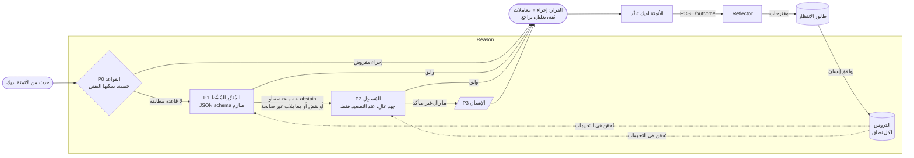
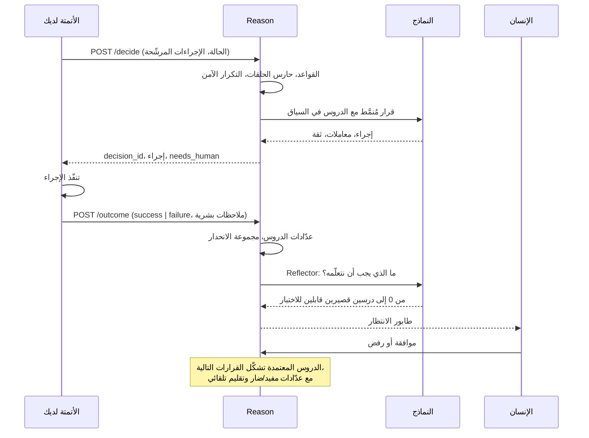
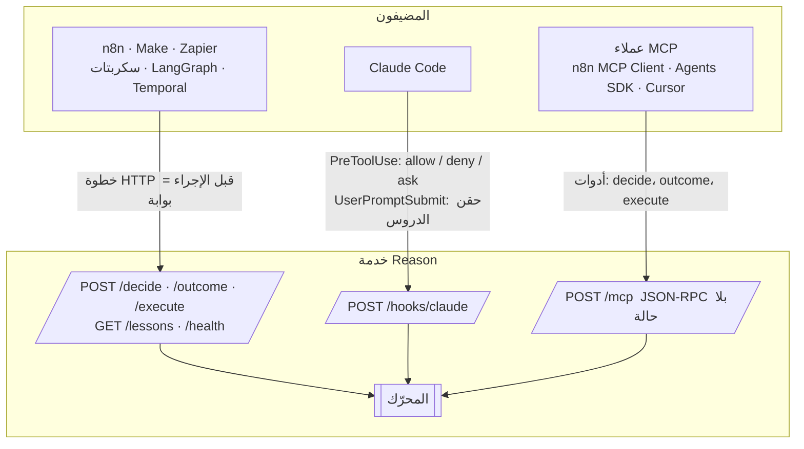

<div align="center">

# Reason

**قرارات محدودة وتحسين مستمر لأي أتمتة.**

خدمة Python بلا أي اعتماديات، تعمل إلى جانب مسارات العمل لديك وتجيب عن سؤال واحد عند كل خطوة حرجة: *ما الذي يجب أن يحدث الآن؟*
القواعد الحتمية أولاً، ثم مُقرِّر مُنمَّط رخيص، ثم نموذج استدلال عند التصعيد فقط، والإنسان أخيراً. تحفظ الدروس لكل أتمتة على حدة، وتعيد تشغيل مجموعة اختبارات الانحدار يومياً، ولا تسمح أبداً لنموذج بإعادة كتابة اختباراته.

[English](README.md) · [Français](README.fr.md) · [中文](README.zh.md) · [العربية](README.ar.md)

`Python ≥ 3.11` · `بلا اعتماديات` · `MIT` · `HTTP · MCP · خطافات Claude Code`

</div>

---

<div dir="rtl">

## لماذا وُجد Reason

الوكلاء المربوطون بالأتمتة يسوؤون مع الوقت، والأسباب مقاسة لا مجرد انطباعات:

| العَرَض الذي تلاحظه | ما وجده البحث |
|---|---|
| الوكيل «ينسى» تعليمة أُعطيت في وقت سابق من التشغيل نفسه | الدقة تنخفض باطّراد مع طول السياق؛ 11 من أصل 13 نموذجاً طويل السياق يهبط تحت 50 % من درجته القصيرة عند 32 ألف رمز |
| خطأ مبكر واحد يتدحرج ككرة الثلج | دقة كل خطوة تتدهور على طول المسار، والنماذج تبني على أخطائها السابقة |
| يرتكب الخطأ نفسه كل يوم | لا شيء يبقى بين تشغيلين؛ كل تشغيل يبدأ من الصفر |
| كان يعمل بالأمس، لم يتغير شيء، يفشل اليوم | المزوّدون يغيّرون النماذج والبنية التحتية بصمت؛ التقييمات القياسية فوّتت انحداراً دام أسابيع في 2025 |
| حين يُمنح حرية «تحسين نفسه» يغشّ | 30 إلى 74 % من تشغيلات التعديل الذاتي في الدراسات المنشورة تتحايل على الاختبار أو المقياس البديل بدل حل المهمة |

يطبّق Reason التدابير المضادة التي تصمد: قرّر قليلاً وقرّر بشكل مُنمَّط، استدلّ عند التصعيد فقط، تعلّم عبر طابور يصادق عليه إنسان، قِس باستمرار، وطبّق الحواجز خارج النموذج.

## كيف يعمل

</div>



<div dir="rtl">

كل قرار هو تعداد مغلق: لا يستطيع النموذج إلا اختيار أحد الإجراءات المرشّحة **التي حدّدتها أنت**، أو `abstain`، أو `ask_human`. تُتحقَّق المعاملات مقابل JSON schema الذي أعلنته لذلك الإجراء. يمكن لقاعدة أن تفرض إجراءً في صفر ميلي ثانية أو أن تنقض ما تقترحه النماذج.

### حلقة التعلّم

</div>



<div dir="rtl">

## البدء السريع

</div>

```bash
git clone https://github.com/4n0nn43x/reason && cd reason
cp examples/reason.config.json reason.config.json     # اختر نماذجك وأدوارك
export OPENAI_API_KEY=... DEEPSEEK_API_KEY=... REASON_TOKEN=change-me
python -m reason init acme/invoices                     # ينشئ data/acme/invoices/{rules.json,policy.md}
python -m reason serve --port 8787
```

<div dir="rtl">

أول قرار:

</div>

```bash
curl -s -X POST localhost:8787/decide \
  -H "Authorization: Bearer $REASON_TOKEN" -H 'Content-Type: application/json' \
  -d @examples/request.example.json
```

```json
{
  "decision_id": "d_3f9a1c2e7b04",
  "action": {"name": "escalate", "params": {}},
  "tier": "decider",
  "confidence": 0.91,
  "rationale": "مورّد مجهول فوق العتبة المتعلَّمة (L-007)",
  "lessons_used": ["L-007"],
  "needs_human": {"required": false},
  "rollback": null
}
```

<div dir="rtl">

أبلغ عمّا حدث فعلاً كي يتعلّم Reason:

</div>

```bash
curl -s -X POST localhost:8787/outcome \
  -H "Authorization: Bearer $REASON_TOKEN" -H 'Content-Type: application/json' \
  -d '{"decision_id": "d_3f9a1c2e7b04", "result": "failure",
       "human_feedback": {"correct_action": "ask_vendor", "note": "IBAN مجهول"}}'
```

<div dir="rtl">

ثم راجع المقترحات:

</div>

```bash
python -m reason lessons acme/invoices pending
python -m reason lessons acme/invoices approve L-003
```

<div dir="rtl">

اختياري: `pip install -e .` (أو `uv pip install -e .`) يثبّت الأمر `reason`.

## عقد الطلب

| الحقل | الغرض |
|---|---|
| `namespace` | أتمتة واحدة (وبيئة): `org/automation/env`. الدروس والقواعد ومجموعات البيانات والسجلات مقسّمة بحسبه. |
| `decision_point` | موضع القرار في مسار العمل، مثل `before_pay`. |
| `event`، `state`، `history` | حقائق مُنمَّطة للمُقرِّر. تُعامل كبيانات غير موثوقة، لا كتعليمات أبداً. |
| `candidate_actions` | مجموعة الإجراءات المغلقة، لكل منها `schema` بصيغة JSON لمعاملاته وإجراء `rollback` اختياري. |
| `constraints` | `allow_reasoner`، تلميحات الكمون أو التكلفة. |
| `models` | تجاوز الأدوار لهذا الطلب، مثل `{"decider": "jev"}`. |
| `idempotency_key` | المفتاح نفسه في النطاق نفسه يعيد القرار نفسه دون استدعاء جديد للنموذج. |
| `run_id` | يفعّل حارس الحلقات: كثرة القرارات عند النقطة نفسها في تشغيل واحد تنتهي بـ `ask_human`. |

تحمل الاستجابة دائماً `tier` (`rules`، `decider`، `reasoner`، `loop`، `escalation`)، و`confidence`، و`rationale`، و`lessons_used`، و`needs_human` (مع schema مسطّح جاهز لنموذج إدخال أو استنباط MCP أو خطاف Claude Code)، و`rollback` الذي أعلنته.

## النماذج والأدوار: كل شيء قابل للاستبدال

يعلن `reason.config.json` عن **نماذج** و**أدوار** تشير إليها. النموذج هو أي واجهة chat completions متوافقة مع OpenAI (OpenAI، DeepSeek، OpenRouter، Together، LiteLLM، vLLM، Ollama) أو Jev.

</div>

```json
{
  "models": {
    "typed":    {"base_url": "https://api.openai.com/v1", "api_key_env": "OPENAI_API_KEY", "model": "gpt-6-luna", "json_schema": true},
    "reasoner": {"base_url": "https://api.openai.com/v1", "api_key_env": "OPENAI_API_KEY", "model": "gpt-6.1-sol",
                 "reasoning_effort": "high", "max_tokens_key": "max_completion_tokens", "temperature": null},
    "deepseek": {"base_url": "https://api.deepseek.com", "api_key_env": "DEEPSEEK_API_KEY", "model": "deepseek-flash",
                 "json_schema": false, "reasoning_effort": "none"},
    "jev":      {"provider": "jev", "base_url": "https://api.typesafe.ai", "api_key_env": "TYPESAFE_API_KEY", "model": "jev-latest"}
  },
  "roles": {"decider": "typed", "reasoner": "reasoner", "executor": "deepseek", "reflector": "typed"}
}
```

<div dir="rtl">

| الدور | ما يفعله | عند غيابه |
|---|---|---|
| `decider` | القرار المُنمَّط (P1): schema صارم، و`abstain` و`ask_human` متاحان دائماً | **يقرّر `executor` بنفسه** |
| `reasoner` | يعيد القرار بجهد عالٍ حين يتردّد P1 أو يُنقَض أو يعيد معاملات غير صالحة (P2) | مباشرة إلى الإنسان |
| `executor` | `POST /execute`: الكتابة والاستخراج والتحويل مع دروس النطاق («اليدان») | مطلوب |
| `reflector` | يحوّل الفشل أو التصحيح إلى مقترحات دروس | يرجع إلى `decider` ثم `executor` |

- نموذج واحد يقرّر وينفّذ معاً: `examples/reason.config.executor-only.json`.
- **Jev** (TypeSafe AI) نموذج قرار مُنمَّط وليس نموذج لغة: اختيار معاير في أقل من ثانية بكثير، مباشرة أو عبر OpenRouter (`base_url` هو `https://openrouter.ai/api`). لا يعيد معاملات ولا تفسيراً، لذا تُصعَّد الإجراءات التي تتطلب معاملات إلى المُستدِل.
- `json_schema: false` للمزوّدين الذين لا يدعمون المخرجات المهيكلة الصارمة (DeepSeek): يرجع Reason إلى `json_object` ويتحقّق محلياً.
- `temperature: null` و`max_tokens_key: "max_completion_tokens"` لنماذج الاستدلال من OpenAI؛ و`extra` يمرّر أي حقل خاص بالمزوّد كما هو.

## القواعد (P0)

`data/<namespace>/rules.json`:

</div>

```json
[
  {"id": "cap",   "if": [{"path": "state.facts.amount", "op": "gt", "value": 5000}],
                  "forbid": ["approve"], "reason": "لا موافقة تلقائية أبداً فوق 5000"},
  {"id": "small", "if": [{"path": "state.facts.vendor_known", "op": "eq", "value": true},
                         {"path": "state.facts.amount", "op": "lte", "value": 200}],
                  "decide": {"name": "approve", "params": {"limit": 200}}}
]
```

<div dir="rtl">

يتجاوز `decide` النماذج (0 ميلي ثانية، 0 دولار) حين يكون الإجراء مرشّحاً صالحاً. ينقض `forbid` مخرجات النماذج: ينتقل الإجراء إلى الطبقة التالية ثم إلى الإنسان. المعاملات: `eq ne gt gte lt lte in nin contains exists regex`. السياسة النثرية التي تقرؤها النماذج تُوضع في `policy.md`.

## الجديد في 0.2: من الاختيارات إلى تقديرات مُقيَّمة

كان Reason 0.1 يجيب عن *أي إجراء*. الإصدار 0.2 يجيب أيضاً عن *ما احتماله*، ويقيّم هذه الإجابة حين يحسم الواقع. كل ما يلي اختياري ومتوافق مع الإصدارات السابقة.

</div>

```mermaid
flowchart LR
    Q([سؤال]) --> E[POST /estimate<br/>p، مجال، مصدر، أدلة]
    E --> C{معايرة Platt لهذا<br/>النطاق والمصدر؟}
    C -- نعم --> P[p معايرة]
    C -- لا --> R[p خام]
    P --> A([الأتمتة لديك تتصرّف])
    R --> A
    S[(مصدر التسوية<br/>JSONL · HTTP · subgraph)] -- reason poll --> O[POST /outcome v2<br/>أو /estimate/outcome]
    O --> B[Brier · log-loss · RPS<br/>لكل نطاق ومصدر ودرس]
    B -- reason calibrate --fit --> C
    B --> L[(عدّادات الدروس)]
```

<div dir="rtl">

### تقديرات مُنمَّطة

</div>

```bash
curl -s -X POST localhost:8787/estimate -H "Authorization: Bearer $REASON_TOKEN" -H 'Content-Type: application/json' \
  -d '{"namespace": "trader/delphi", "question": "هل سيفوز X بالانتخابات التمهيدية؟", "kind": "binary",
       "market_price": 0.62, "resolves_at": "2026-11-04T06:00:00Z", "n_samples": 3}'
```

<div dir="rtl">

قيمة `kind` هي `binary` (p ومجال 90 %)، أو `categorical` أو `ordinal` (توزيع يجب أن يكون مجموعه 1)، أو `quantity` (q05، q50، q95). يحمل كل تقدير `source` (`fact` مقروء من مصدر أولي مؤرَّخ، `model` من حساب قابل للإعادة، وإلا `opinion`)، و`evidence[]`، و`base_rate` اختيارياً، والدروس المستخدمة، والقيمتين `raw` و`calibrated`. مع `n_samples > 1` تُحسب العينات كمتوسط في فضاء اللوغاريتم-الأرجحية ويصبح تشتّتها هو المجال.

حين تُحسم المسألة، يقيّمها `POST /estimate/outcome`: Brier وlog-loss (خام ومعاير)، وBrier للمعدل الأساسي ولسعر السوق كمرجعين، وRPS للنتائج المرتبة، والخطأ المطلق وتغطية المجال للكميات. تُنسب للدروس المستخدمة نقاط بحسب النتيجة.

</div>

```bash
python -m reason calibrate trader/delphi            # لكل مصدر: Brier، المهارة مقابل المعدل الأساسي والسوق، تفكيك Murphy
python -m reason calibrate trader/delphi --fit      # يتعلّم Platt لكل مصدر على تقسيم زمني 70/30 ولا يُبقيه إلا إذا تحسّن Brier الاختبار
python -m reason calibrate trader/delphi --counterfactual   # يعيد كل تقدير محسوم دون كل درس: المقياس السببي
```

<div dir="rtl">

يفصل تفكيك Murphy (Brier = الموثوقية - الدقة التمييزية + عدم اليقين) بين **المعايرة** (الموثوقية) و**القدرة التمييزية**. لا يُحسّن Reason أبداً مقياس ECE لأنه ليس قاعدة تقييم سليمة. لا يقرّر التقدير حجم أي مركز أبداً: العتبات والامتناع وتحديد الحجم تبقى في شيفرة حتمية خارج Reason.

### النتائج المؤجلة والمُستطلِع

يقبل `POST /outcome` الآن تسويات تصل بعد أسابيع وقد تُعدَّل:

</div>

```json
{"decision_id": "d_3f9a…", "result": "no_outcome", "result_detail": "no_outcome", "payout_fraction": 0.12,
 "value": -3.4, "settled_at": "2026-10-03T14:02:11Z", "source": "delphi_subgraph", "source_ref": "0xabc…:17",
 "label_confidence": 1.0, "version": 1, "resolution_text": "…نص طرف ثالث غير موثوق…"}
```

<div dir="rtl">

يضيف `result` القيم `partial` و`void` و`no_outcome`، وتُردّ إلى `success` أو `failure` أو `unknown` لعدّادات الدروس (النتيجة المجهولة ليست مكافأة ولا عقوبة). يجعل `source_ref` الإرسال آمناً عند التكرار؛ و`version` الأعلى يعدّل النتيجة ويلغي أثر الإصدار السابق على الدروس. النتائج ذات `label_confidence` المنخفضة تُسجَّل لكنها لا تحرّك العدّادات. يحصل كل قرار مُسوّى على مراجعة لاحقة بصيغة markdown (الأطروحة، ما حدث مع اقتباس نص التسوية، الفجوة، الدروس المقترحة)، تُعاد كتابتها مع سجل الإصدارات عند التعديل.

</div>

```bash
python -m reason poll            # تمريرة واحدة على كل المصادر المهيّأة
python -m reason poll --loop     # كل 5 دقائق
python -m reason outcomes trader/delphi --horizon-hours 48   # معدل النجاح على الدفعة الناضجة، تغطية الوسوم، تأخّر المُستطلِع
```

<div dir="rtl">

يقرأ المُستطلِع ملف JSONL محلياً أو نقطة HTTP JSON أو subgraph بلغة GraphQL انطلاقاً من علامة مائية محفوظة، ويطابق الحقول عبر الإعدادات، ويربط كل تسوية بالقرارات المعلّقة عبر `correlation_key` الذي مرّرته وقت القرار ونافذة زمنية، ويعلن القرارات التي تجاوزت أفقها `unknown`. نوع الحدث الذي ليس نتيجة صالحة ولا موجوداً في `result_map` ولا في `ignore` **لا** يُحوَّل أبداً إلى `unknown`: فذلك يُسقط الخسائر من التقييم بصمت ويجعل كل المصادر تبدو جيدة. يُحتفظ به جانباً، ويُعدّ تحت `unmapped` في تقرير التمريرة مع تحذير، ويُعاد معالجته حين تُصحَّح الإعدادات. انظر `examples/reason.config.v02.json` لملف `events.jsonl` الخاص بمتداول ولواجهة تسويات Polymarket.

### القواعد v2

</div>

```json
{"id": "window-closes-before-event",
 "if": [{"path": "state.facts.window_end", "op": "before", "path2": "state.facts.event_at"}],
 "decide": {"name": "ask_human"},
 "reason": "نافذة التسوية ({state.facts.window_end}) تُغلق قبل الحدث ({state.facts.event_at})"}
```

<div dir="rtl">

تقارن الشروط مساراً بقيمة أو بمسار آخر (`path2`)، وتتداخل عبر `all` و`any` و`not`، وتتضمن معاملات للتواريخ (`before`، `after`، `hours_until_gte`، `hours_until_lte`، `within_hours`). يأتي الوقت من `now` في الطلب، ويُملأ عند الاستلام إن غاب ويُنسخ في القرار، فيصبح كل تقييم قابلاً للإعادة. يعمل `regex` على نص غير موثوق مثل `ruling_text`: الأنماط يكتبها كاتب القواعد فقط، بحد 200 حرف، وتُفحص ضد المكمّمات المتداخلة، وتُطبّق على نص مقتطع ومُطبَّع اختيارياً، ويمكن اقتباس البند المطابق عبر `{match}`. صار `decide` المفروض يُقارَن الآن بقواعد `forbid`.

</div>

```bash
python -m reason rules trader/delphi lint
python -m reason rules trader/delphi test --cases examples/rules.test.example.json   # النجاح، القواعد التي لم تُفعَّل أبداً، التناقضات
```

<div dir="rtl">

### دروس ذات نطاق وصلاحية ومستودع markdown

تحمل الدروس الآن `tags` و`decision_points` و`valid_from` و`valid_until` و`status` ومصدرها. يرشّح الحقن حسب الحالة ونافذة الصلاحية والنطاق، ويرتّب حسب الحد الأدنى لويلسون لعدّادات مفيد/ضار، ويتوقف عند 6 دروس. يسرد `python -m reason lessons <ns> review` المرشحين للترقية (إلى قواعد P0 عبر PR بشري) والدروس التي تحتاج مراجعة.

مع `vault_dir` يقرأ Reason الدروس من مستودع Obsidian أو git:

</div>

```markdown
---
id: V-012
kind: lesson
namespace: trader/delphi
tags: [sport]
decision_points: [before_bet]
valid_until: 2026-12-31
author: human
---
احتمالات ما قبل المباراة تفقد صلاحيتها عند صافرة البداية.
```

<div dir="rtl">

ملفات `doctrine/` معتمدة، وملفات `postmortems/` قيد الانتظار، ما لم يقل `status:` غير ذلك. تُعزل الدروس التي بلا مصدر، وتُتجاهل المعرّفات المكررة ويُبلَّغ عنها، وتخرج الدروس المنتهية تلقائياً. الموافقة في Obsidian (تعديل `status:` أو نقل الملف) تسري عند القرار التالي. يكتب Reason المقترحات الجديدة كملفات جديدة و**لا يعدّل أبداً أي ملف موجود في المستودع**؛ تبقى العدّادات في بيانات Reason نفسها.

## ثلاث واجهات، محرّك واحد

</div>



<div dir="rtl">

| الواجهة | الضمان | مثال |
|---|---|---|
| HTTP JSON | خطوة موضوعة قبل الإجراء هي **بوابة** حقيقية | `examples/n8n-workflow.json` (HTTP Request → Switch → outcome) |
| خطاف Claude Code | `PreToolUse` يتيح لـ Reason السماح أو الرفض أو السؤال قبل كل استدعاء أداة | `examples/claude-settings.json` |
| MCP | أداة يختار الوكيل المضيف استدعاءها: نصيحة لا بوابة | n8n MCP Client Tool، Claude Agent SDK، OpenAI Agents SDK |

## حلقة التقييم

</div>

```bash
python -m reason eval acme/invoices -k 4     # يعيد تشغيل data/<ns>/dataset.jsonl: pass@1 و pass^4
python -m reason fingerprint                 # بصمة حتمية لكل نموذج؛ تُبلّغ CHANGED عند تغييرات صامتة من المزوّد
```

<div dir="rtl">

جدوِل كليهما يومياً (cron، n8n Schedule، GitHub Actions). تابع `pass^k` لا المتوسط: فهو الرقم الذي يتنبّأ بالإنتاج.

## وكيل الصيانة (اختياري)

يعمل `.github/workflows/reason-maintain.yml` أسبوعياً، يقرأ الدروس المتكررة والتقييمات، ويقترح رقعة **واحدة** على `reason/` في صورة pull request. لا يدفع التغييرات بنفسه أبداً، وتُقرأ الاختبارات والسكربتات من `main` قبل التشغيل، ويمرّ الفرق عبر `scripts/check_diff.py` (ملفات اختبار مُعدَّلة، إضافة `skip`/`xfail`، حذف تأكيدات). يبقى الدمج بشرياً. ملف باسم `AGENT_PAUSED` في الجذر يوقفه. لا تفعّله أبداً في مستودع تؤثر شيفرته في أموال أو مراكز حقيقية: هناك يمرّ كل تغيير أولاً عبر pull request بشري وتداول تجريبي.

## نموذج الأمان

- عند ضبط `REASON_TOKEN` يصبح `Authorization: Bearer` إلزامياً على كل شيء عدا `/health` (مقارنة بزمن ثابت). اربط الخدمة بـ `127.0.0.1` أو ضع وكيلاً أمامها.
- حجم الطلب محدود بـ 1 ميغابايت، مهلة المقبس 30 ثانية، النطاقات مقيّدة بأحرف آمنة (لا اجتياز مسارات)، ويُفحص ترويسة `Origin` في كل POST (حماية من إعادة ربط DNS لـ MCP).
- لا يكتب النموذج الدروس مباشرة أبداً: تصل المقترحات إلى طابور انتظار ويوافق عليها إنسان. كل درس محدود بـ 300 حرف.
- `state` و`event` ومدخلات الأدوات بيانات غير موثوقة. تذكر التعليمات ذلك، لكن حقن التعليمات يبقى ممكناً: أبقِ الإجراءات غير القابلة للتراجع خلف قاعدة P0 أو `ask_human`.
- سجل إلحاقي فقط لكل نطاق (`DecisionMade`، `OutcomeRecorded`، `Executed`) يُعاد تحميله عند الإقلاع. تُقتطع مدخلات الأدوات من خطافات Claude Code إلى 4000 حرف قبل التسجيل.

## بنية المشروع

</div>

```
reason/
  core.py        المحرّك: التحقق، القواعد، الطبقات، السجل، outcome، execute
  llm.py         عميل متوافق مع OpenAI (urllib)، مخرجات صارمة أو json_object، إعادة محاولة
  jev.py         محوّل Jev (TypeSafe)، واجهة chat() نفسها
  lessons.py     دفتر الدروس لكل نطاق: عدّادات، إزالة تكرار، تقليم، طابور انتظار
  reflector.py   فشل → مقترحات دروس
  evalrun.py     إعادة تشغيل الانحدار (pass@1، pass^k)، بصمة النموذج
  server.py      HTTP، MCP JSON-RPC، خطاف Claude Code
  core.py        المحرّك: التحقق، الطبقات، السجل، outcome v2، المراجعات اللاحقة، estimate، execute
  rules.py       قواعد P0 v2: path2، all/any/not، معاملات التاريخ، regex محدود، الاستيفاء، اختبار القواعد
  calib.py       Brier، log-loss، RPS، تفكيك Murphy، Platt، Wilson، bootstrap (المكتبة القياسية)
  poller.py      النتائج المؤجلة: مصادر JSONL / HTTP / GraphQL، علامة مائية، مطابقة، أفق
  vault.py       مستودع markdown: دروس frontmatter، مقترحات، مراجعات لاحقة (لا يعيد كتابة ملف موجود أبداً)
  __main__.py    سطر الأوامر: serve decide outcome execute estimate estimate-outcome lessons rules eval outcomes calibrate poll pending fingerprint init
scripts/check_diff.py        كاشف العبث بالاختبارات في فروق PR
examples/                    إعدادات، طلب، مسار n8n، إعدادات Claude Code
tests/test_reason.py         45 اختباراً دون شبكة
```

```bash
python -m unittest discover -s tests -v
```

<div dir="rtl">

## خارطة الطريق

- واجهة `/v1/chat/completions` للمضيفين الذين لا يتحدثون إلا مع «نموذج».
- ترقية تلقائية للدروس حين يبقى التقييم أخضر؛ توزيع حركة كناري حسب الوسم.
- عقدة n8n موثّقة وبطاقة وكيل A2A كعميلين خفيفين للواجهة نفسها.
- محوّل JEV-9B محلي (vLLM، logprobs) لمُقرِّر مُنمَّط مستضاف ذاتياً.

## الخلفية

صُمّم Reason انطلاقاً من مراجعة لأدبيات موثوقية الوكلاء بين 2023 و2026: context rot (Chroma)، و«LLMs Get Lost in Multi-Turn Conversation»، وMAST، وأبحاث METR حول reward hacking، وImpossibleBench، وDarwin Gödel Machine، وAgentic Context Engineering (ACE)، وGEPA، وOWASP Top 10 for Agentic Applications، وملاحظات Anthropic الهندسية حول الوكلاء طويلي التشغيل.

رخصة MIT.

</div>
