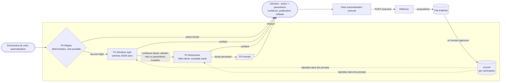
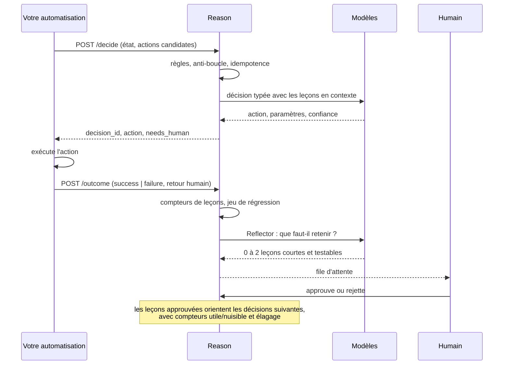
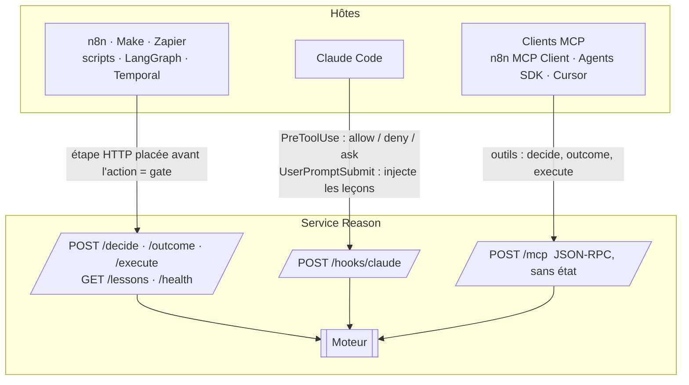

<div align="center">

# Reason

**Décisions bornées et amélioration continue pour n'importe quelle automatisation.**

Un service Python sans dépendance qui se place à côté de vos workflows et répond à une seule question à chaque étape critique : *que doit-il se passer maintenant ?*
Les règles déterministes d'abord, un décideur typé bon marché ensuite, un modèle de raisonnement seulement sur escalade, un humain en dernier. Il retient des leçons par automatisation, rejoue un jeu de régression chaque jour, et ne laisse jamais un modèle réécrire ses propres tests.

[English](README.md) · [Français](README.fr.md) · [中文](README.zh.md) · [العربية](README.ar.md)

`Python ≥ 3.11` · `zéro dépendance` · `MIT` · `HTTP · MCP · hooks Claude Code`

</div>

---

## Pourquoi Reason existe

Les agents branchés dans des automatisations se dégradent avec le temps, et les causes sont mesurées, pas anecdotiques :

| Symptôme observé | Ce que la recherche a établi |
|---|---|
| L'agent « oublie » une consigne donnée plus tôt dans la même exécution | La précision baisse régulièrement avec la longueur du contexte ; 11 modèles sur 13 tombent sous 50 % de leur score court dès 32k tokens |
| Une erreur précoce fait boule de neige | La précision par étape se dégrade le long de la trajectoire et les modèles se conditionnent sur leurs propres erreurs passées |
| Il refait la même erreur chaque jour | Rien ne persiste entre deux exécutions ; chaque run repart de zéro |
| Ça marchait hier, rien n'a changé, ça échoue aujourd'hui | Les fournisseurs changent modèles et infrastructure en silence ; les evals standard ont raté une régression de plusieurs semaines en 2025 |
| Laissé libre de « s'améliorer », il triche | 30 à 74 % des runs auto-modifiants des études publiées contournent le test ou la métrique au lieu de résoudre la tâche |

Reason applique les contre-mesures qui tiennent : décider peu et décider typé, raisonner seulement sur escalade, apprendre à travers une file validée par un humain, mesurer en continu, et appliquer les garde-fous hors du modèle.

## Comment ça marche



Chaque décision est un enum fermé : le modèle ne peut choisir qu'une de **vos** actions candidates, ou `abstain`, ou `ask_human`. Les paramètres sont validés contre le schéma JSON que vous avez déclaré pour cette action. Une règle peut forcer une action en zéro milliseconde ou opposer un veto à ce que proposent les modèles.

### La boucle d'apprentissage



## Démarrage rapide

```bash
git clone https://github.com/4n0nn43x/reason && cd reason
cp examples/reason.config.json reason.config.json     # choisissez vos modèles et rôles
export OPENAI_API_KEY=... DEEPSEEK_API_KEY=... REASON_TOKEN=a-changer
python -m reason init acme/invoices                     # crée data/acme/invoices/{rules.json,policy.md}
python -m reason serve --port 8787
```

Première décision :

```bash
curl -s -X POST localhost:8787/decide \
  -H "Authorization: Bearer $REASON_TOKEN" -H 'Content-Type: application/json' \
  -d @examples/request.example.json
```

```json
{
  "decision_id": "d_3f9a1c2e7b04",
  "action": {"name": "escalate", "params": {}},
  "tier": "decider",
  "confidence": 0.91,
  "rationale": "fournisseur inconnu au-dessus du seuil appris (L-007)",
  "lessons_used": ["L-007"],
  "needs_human": {"required": false},
  "rollback": null
}
```

Renvoyez ce qui s'est réellement passé, pour que Reason apprenne :

```bash
curl -s -X POST localhost:8787/outcome \
  -H "Authorization: Bearer $REASON_TOKEN" -H 'Content-Type: application/json' \
  -d '{"decision_id": "d_3f9a1c2e7b04", "result": "failure",
       "human_feedback": {"correct_action": "ask_vendor", "note": "IBAN inconnu"}}'
```

Puis relisez les propositions :

```bash
python -m reason lessons acme/invoices pending
python -m reason lessons acme/invoices approve L-003
```

Optionnel : `pip install -e .` (ou `uv pip install -e .`) installe la commande `reason`.

## Le contrat de requête

| Champ | Rôle |
|---|---|
| `namespace` | Une automatisation (et un environnement) : `org/automation/env`. Leçons, règles, jeux de données et journaux sont partitionnés dessus. |
| `decision_point` | L'endroit du workflow où la décision se prend, par exemple `before_pay`. |
| `event`, `state`, `history` | Faits typés pour le décideur. Traités comme des données non fiables, jamais comme des instructions. |
| `candidate_actions` | L'ensemble fermé des actions, chacune avec un `schema` JSON pour ses paramètres et une procédure de `rollback` optionnelle. |
| `constraints` | `allow_reasoner`, indications de latence ou de coût. |
| `models` | Surcharge des rôles pour cette requête, par exemple `{"decider": "jev"}`. |
| `idempotency_key` | La même clé dans le même namespace renvoie la même décision sans nouvel appel modèle. |
| `run_id` | Active l'anti-boucle : trop de décisions au même point dans un run finissent en `ask_human`. |

La réponse porte toujours `tier` (`rules`, `decider`, `reasoner`, `loop`, `escalation`), `confidence`, `rationale`, `lessons_used`, `needs_human` (avec un schéma plat prêt pour un formulaire, une élicitation MCP ou un hook Claude Code) et le `rollback` déclaré.

## Modèles et rôles : tout est interchangeable

`reason.config.json` déclare des **modèles** et des **rôles** qui pointent vers eux. Un modèle est n'importe quelle API chat completions compatible OpenAI (OpenAI, DeepSeek, OpenRouter, Together, LiteLLM, vLLM, Ollama) ou Jev.

```json
{
  "models": {
    "typed":    {"base_url": "https://api.openai.com/v1", "api_key_env": "OPENAI_API_KEY", "model": "gpt-6-luna", "json_schema": true},
    "reasoner": {"base_url": "https://api.openai.com/v1", "api_key_env": "OPENAI_API_KEY", "model": "gpt-6.1-sol",
                 "reasoning_effort": "high", "max_tokens_key": "max_completion_tokens", "temperature": null},
    "deepseek": {"base_url": "https://api.deepseek.com", "api_key_env": "DEEPSEEK_API_KEY", "model": "deepseek-flash",
                 "json_schema": false, "reasoning_effort": "none"},
    "jev":      {"provider": "jev", "base_url": "https://api.typesafe.ai", "api_key_env": "TYPESAFE_API_KEY", "model": "jev-latest"}
  },
  "roles": {"decider": "typed", "reasoner": "reasoner", "executor": "deepseek", "reflector": "typed"}
}
```

| Rôle | Fait quoi | Si absent |
|---|---|---|
| `decider` | La décision typée (P1) : schéma strict, `abstain` et `ask_human` toujours disponibles | **l'`executor` décide lui-même** |
| `reasoner` | Relance la décision à effort élevé quand P1 doute, est interdit par une règle ou renvoie des paramètres invalides (P2) | directement l'humain |
| `executor` | `POST /execute` : rédaction, extraction, transformation avec les leçons du namespace (les « mains ») | obligatoire |
| `reflector` | Transforme un échec ou une correction en propositions de leçons | retombe sur `decider`, puis `executor` |

- Un seul modèle qui décide et exécute : `examples/reason.config.executor-only.json`.
- **Jev** (TypeSafe AI) est un modèle de décision typée, pas un LLM : choix calibré en bien moins d'une seconde, directement ou via OpenRouter (`base_url` `https://openrouter.ai/api`). Il ne renvoie ni paramètres ni explication, donc les actions qui exigent des paramètres sont escaladées au raisonneur.
- `json_schema: false` pour les fournisseurs sans sorties structurées strictes (DeepSeek) : Reason passe en `json_object` et valide localement.
- `temperature: null` et `max_tokens_key: "max_completion_tokens"` pour les modèles de raisonnement OpenAI ; `extra` transmet tel quel tout champ propre au fournisseur.

## Règles (P0)

`data/<namespace>/rules.json` :

```json
[
  {"id": "cap",   "if": [{"path": "state.facts.amount", "op": "gt", "value": 5000}],
                  "forbid": ["approve"], "reason": "jamais d'approbation automatique au-dessus de 5000"},
  {"id": "small", "if": [{"path": "state.facts.vendor_known", "op": "eq", "value": true},
                         {"path": "state.facts.amount", "op": "lte", "value": 200}],
                  "decide": {"name": "approve", "params": {"limit": 200}}}
]
```

`decide` court-circuite les modèles (0 ms, 0 $) quand l'action est une candidate valide. `forbid` oppose un veto à la sortie des modèles : l'action passe au palier suivant, puis à l'humain. Opérateurs : `eq ne gt gte lt lte in nin contains exists regex`. La politique en prose, lue par les modèles, va dans `policy.md`.

## Trois façades, un moteur



| Façade | Garantie | Exemple |
|---|---|---|
| HTTP JSON | Une étape placée avant l'action est un vrai **gate** | `examples/n8n-workflow.json` (HTTP Request → Switch → outcome) |
| Hook Claude Code | `PreToolUse` laisse Reason autoriser, refuser ou demander avant chaque appel d'outil | `examples/claude-settings.json` |
| MCP | Un outil que l'agent hôte choisit d'appeler : du conseil, pas un gate | n8n MCP Client Tool, Claude Agent SDK, OpenAI Agents SDK |

## Boucle d'évaluation

```bash
python -m reason eval acme/invoices -k 4     # rejoue data/<ns>/dataset.jsonl : pass@1 et pass^4
python -m reason fingerprint                 # signature déterministe par modèle ; CHANGED si le fournisseur a changé quelque chose
```

À planifier chaque jour (cron, n8n Schedule, GitHub Actions). Suivez `pass^k`, pas la moyenne : c'est le chiffre qui prédit la production.

## Agent de maintenance (optionnel)

`.github/workflows/reason-maintain.yml` tourne chaque semaine, lit les leçons récurrentes et les evals, et propose **un** patch sur `reason/` sous forme de pull request. Il ne pousse jamais lui-même, tests et scripts sont relus depuis `main` avant exécution, et le diff passe par `scripts/check_diff.py` (fichiers de tests touchés, `skip`/`xfail` ajoutés, assertions supprimées). La fusion reste humaine. Un fichier `AGENT_PAUSED` à la racine le suspend.

## Modèle de sécurité

- `REASON_TOKEN` défini → `Authorization: Bearer` obligatoire sur tout sauf `/health` (comparaison à temps constant). Liez le service à `127.0.0.1` ou placez un proxy devant.
- Corps limités à 1 Mo, délai socket de 30 s, namespaces restreints à des caractères sûrs (pas de traversée de chemin), en-tête `Origin` vérifié sur chaque POST (protection DNS rebinding pour MCP).
- Les leçons ne sont jamais écrites directement par un modèle : les propositions arrivent dans une file d'attente et sont approuvées par un humain. Chaque leçon est limitée à 300 caractères.
- `state`, `event` et les entrées d'outils sont des données non fiables. Les prompts le disent, mais l'injection reste possible : gardez les actions irréversibles derrière une règle P0 ou `ask_human`.
- Journal append-only par namespace (`DecisionMade`, `OutcomeRecorded`, `Executed`), rechargé au démarrage. Les entrées d'outils des hooks Claude Code sont tronquées à 4 000 caractères avant journalisation.

## Arborescence

```
reason/
  core.py        moteur : validation, règles, paliers, journal, outcome, execute
  llm.py         client compatible OpenAI (urllib), sortie stricte ou json_object, relances
  jev.py         adaptateur Jev (TypeSafe), même interface chat()
  lessons.py     playbook par namespace : compteurs, dédup, élagage, file d'attente
  reflector.py   échec → propositions de leçons
  evalrun.py     rejeu de régression (pass@1, pass^k), empreinte de modèle
  server.py      HTTP, MCP JSON-RPC, hook Claude Code
  __main__.py    CLI : serve decide outcome execute lessons eval fingerprint init
scripts/check_diff.py        détecteur de falsification de tests dans un diff
examples/                    config, requête, workflow n8n, settings Claude Code
tests/test_reason.py         24 tests hors ligne
```

```bash
python -m unittest discover -s tests -v
```

## Feuille de route

- Façade `/v1/chat/completions` pour les hôtes qui ne savent parler qu'à un « modèle ».
- Promotion automatique des leçons quand l'eval reste verte ; split de trafic canari par label.
- Nœud n8n vérifié et Agent Card A2A comme clients fins de la même API.
- Adaptateur JEV-9B local (vLLM, logprobs) pour un décideur typé auto-hébergé.

## Contexte

Reason a été conçu à partir d'une revue de la littérature 2023-2026 sur la fiabilité des agents : context rot (Chroma), « LLMs Get Lost in Multi-Turn Conversation », MAST, METR sur le reward hacking, ImpossibleBench, la Darwin Gödel Machine, Agentic Context Engineering (ACE), GEPA, l'OWASP Top 10 for Agentic Applications, et les notes d'ingénierie d'Anthropic sur les agents longue durée.

Licence MIT.
