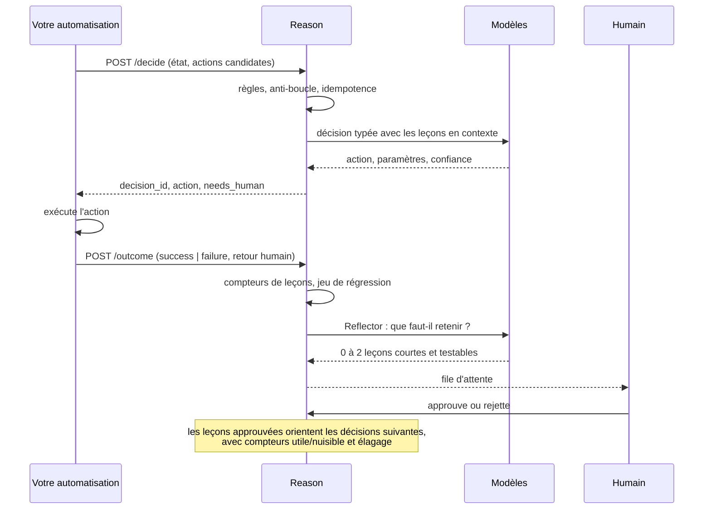
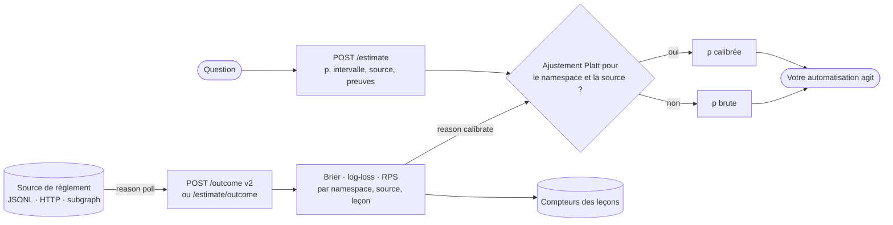
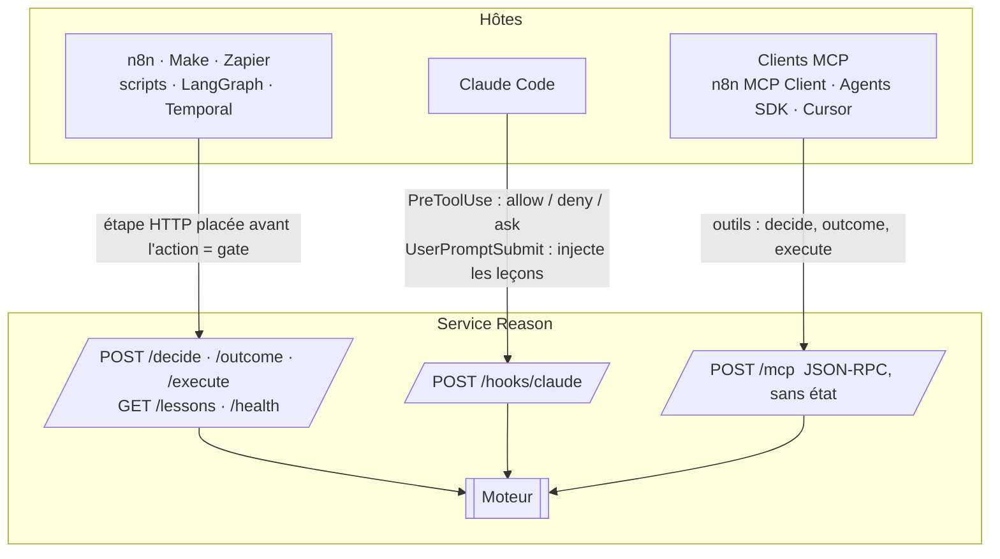

<div align="center">

# Reason

**Décisions bornées et amélioration continue pour n'importe quelle automatisation.**

Un service Python sans dépendance qui se place à côté de vos workflows et répond à une seule question à chaque étape critique : *que doit-il se passer maintenant ?*
Les règles déterministes d'abord, un décideur typé bon marché ensuite, un modèle de raisonnement seulement sur escalade, un humain en dernier. Il retient des leçons par automatisation, rejoue un jeu de régression chaque jour, et ne laisse jamais un modèle réécrire ses propres tests.

[English](README.md) · [Français](README.fr.md) · [中文](README.zh.md) · [العربية](README.ar.md)

`Python ≥ 3.11` · `zéro dépendance` · `MIT` · `HTTP · MCP · hooks Claude Code`

Notes de version et historique : [CHANGELOG.md](CHANGELOG.md).

</div>

---

## Pourquoi Reason existe

Les agents branchés dans des automatisations se dégradent avec le temps, et les causes sont mesurées, pas anecdotiques :

| Symptôme observé | Ce que la recherche a établi |
|---|---|
| L'agent « oublie » une consigne donnée plus tôt dans la même exécution | La précision baisse régulièrement avec la longueur du contexte ; 11 modèles sur 13 tombent sous 50 % de leur score court dès 32k tokens |
| Une erreur précoce fait boule de neige | La précision par étape se dégrade le long de la trajectoire et les modèles se conditionnent sur leurs propres erreurs passées |
| Il refait la même erreur chaque jour | Rien ne persiste entre deux exécutions ; chaque run repart de zéro |
| Ça marchait hier, rien n'a changé, ça échoue aujourd'hui | Les fournisseurs changent modèles et infrastructure en silence ; les evals standard ont raté une régression de plusieurs semaines en 2025 |
| Laissé libre de « s'améliorer », il triche | 30 à 74 % des runs auto-modifiants des études publiées contournent le test ou la métrique au lieu de résoudre la tâche |

Sources : [NoLiMa, ICML 2025](https://proceedings.mlr.press/v267/modarressi25a.html) · [Sinha et al., ICLR 2026](https://arxiv.org/abs/2509.09677) · [Anthropic, agents longue durée](https://www.anthropic.com/engineering/effective-harnesses-for-long-running-agents) · [post-mortem Anthropic, sept. 2025](https://www.anthropic.com/engineering/a-postmortem-of-three-recent-issues) · [METR, reward hacking](https://metr.org/blog/2025-06-05-recent-reward-hacking/) · [Reward Hacking in Self-Improving Code Agents, atelier ICLR 2026](https://iclr.cc/virtual/2026/10018648)

Reason applique les contre-mesures qui tiennent : décider peu et décider typé, raisonner seulement sur escalade, apprendre à travers une file validée par un humain, mesurer en continu, et appliquer les garde-fous hors du modèle.

## Comment ça marche


Chaque décision est un enum fermé : le modèle ne peut choisir qu'une de **vos** actions candidates, ou `abstain`, ou `ask_human`. Les paramètres sont validés contre le schéma JSON que vous avez déclaré pour cette action. Une règle peut forcer une action en zéro milliseconde ou opposer un veto à ce que proposent les modèles.

### La boucle d'apprentissage



## Démarrage rapide

```bash
git clone https://github.com/4n0nn43x/reason && cd reason
cp examples/reason.config.json reason.config.json     # choisissez vos modèles et rôles
export OPENAI_API_KEY=... DEEPSEEK_API_KEY=... REASON_TOKEN=a-changer
python -m reason init acme/invoices                     # crée data/acme/invoices/{rules.json,policy.md}
python -m reason serve --port 8787
```

Première décision :

```bash
curl -s -X POST localhost:8787/decide \
  -H "Authorization: Bearer $REASON_TOKEN" -H 'Content-Type: application/json' \
  -d @examples/request.example.json
```

```json
{
  "decision_id": "d_3f9a1c2e7b04",
  "action": {"name": "escalate", "params": {}},
  "tier": "decider",
  "confidence": 0.91,
  "rationale": "fournisseur inconnu au-dessus du seuil appris (L-007)",
  "lessons_used": ["L-007"],
  "needs_human": {"required": false},
  "rollback": null
}
```

Renvoyez ce qui s'est réellement passé, pour que Reason apprenne :

```bash
curl -s -X POST localhost:8787/outcome \
  -H "Authorization: Bearer $REASON_TOKEN" -H 'Content-Type: application/json' \
  -d '{"decision_id": "d_3f9a1c2e7b04", "result": "failure",
       "human_feedback": {"correct_action": "ask_vendor", "note": "IBAN inconnu"}}'
```

Puis relisez les propositions :

```bash
python -m reason lessons acme/invoices pending
python -m reason lessons acme/invoices approve L-003
```

Optionnel : `pip install -e .` (ou `uv pip install -e .`) installe la commande `reason`.

## Le contrat de requête

| Champ | Rôle |
|---|---|
| `namespace` | Une automatisation (et un environnement) : `org/automation/env`. Leçons, règles, jeux de données et journaux sont partitionnés dessus. |
| `decision_point` | L'endroit du workflow où la décision se prend, par exemple `before_pay`. |
| `event`, `state`, `history` | Faits typés pour le décideur. Traités comme des données non fiables, jamais comme des instructions. |
| `candidate_actions` | L'ensemble fermé des actions, chacune avec un `schema` JSON pour ses paramètres et une procédure de `rollback` optionnelle. |
| `constraints` | `allow_reasoner`, indications de latence ou de coût. |
| `models` | Surcharge des rôles pour cette requête, par exemple `{"decider": "jev"}`. |
| `idempotency_key` | La même clé dans le même namespace renvoie la même décision sans nouvel appel modèle. |
| `run_id` | Active l'anti-boucle : trop de décisions au même point dans un run finissent en `ask_human`. |

La réponse porte toujours `tier` (`rules`, `decider`, `reasoner`, `loop`, `escalation`), `confidence`, `rationale`, `lessons_used`, `needs_human` (avec un schéma plat prêt pour un formulaire, une élicitation MCP ou un hook Claude Code) et le `rollback` déclaré.

## Modèles et rôles : tout est interchangeable

`reason.config.json` déclare des **modèles** et des **rôles** qui pointent vers eux. Un modèle est n'importe quelle API chat completions compatible OpenAI (OpenAI, DeepSeek, OpenRouter, Together, LiteLLM, vLLM, Ollama), l'API Messages d'Anthropic (Claude, `"provider": "anthropic"`) ou Jev. Aucun n'est obligatoire : combinez-les librement.

```json
{
  "models": {
    "typed":    {"base_url": "https://api.openai.com/v1", "api_key_env": "OPENAI_API_KEY", "model": "gpt-6-luna", "json_schema": true},
    "reasoner": {"base_url": "https://api.openai.com/v1", "api_key_env": "OPENAI_API_KEY", "model": "gpt-6.1-sol",
                 "reasoning_effort": "high", "max_tokens_key": "max_completion_tokens", "temperature": null},
    "deepseek": {"base_url": "https://api.deepseek.com", "api_key_env": "DEEPSEEK_API_KEY", "model": "deepseek-flash",
                 "json_schema": false, "reasoning_effort": "none"},
    "jev":      {"provider": "jev", "base_url": "https://api.typesafe.ai", "api_key_env": "TYPESAFE_API_KEY", "model": "jev-latest"}
  },
  "roles": {"decider": "typed", "reasoner": "reasoner", "executor": "deepseek", "reflector": "typed"}
}
```

| Rôle | Fait quoi | Si absent |
|---|---|---|
| `decider` | La décision typée (P1) : schéma strict, `abstain` et `ask_human` toujours disponibles | **l'`executor` décide lui-même** |
| `reasoner` | Relance la décision à effort élevé quand P1 doute, est interdit par une règle ou renvoie des paramètres invalides (P2) | directement l'humain |
| `executor` | `POST /execute` : rédaction, extraction, transformation avec les leçons du namespace (les « mains ») | obligatoire |
| `reflector` | Transforme un échec ou une correction en propositions de leçons | retombe sur `decider`, puis `executor` |

- Un seul modèle qui décide et exécute : `examples/reason.config.executor-only.json`.
- **Claude** en natif : `{"provider": "anthropic", "base_url": "https://api.anthropic.com/v1", "api_key_env": "ANTHROPIC_API_KEY", "model": "claude-opus-5-5", "reasoning_effort": "high"}`. `reasoning_effort` devient `output_config.effort` (`low` à `max`), le schéma de décision passe par les sorties structurées, `temperature` n'est jamais envoyé, et la réponse est lue en streaming pour qu'une longue génération ne dépasse pas `timeout` (il s'applique à chaque lecture). Utilisable pour n'importe quel rôle.
- **Jev** (TypeSafe AI) est optionnel, jamais chargé tant qu'aucun modèle ne déclare `"provider": "jev"`. C'est un modèle de décision typée, pas un LLM : choix calibré en bien moins d'une seconde, directement ou via OpenRouter (`base_url` `https://openrouter.ai/api`). Il ne renvoie ni paramètres ni explication, donc les actions qui exigent des paramètres sont escaladées au raisonneur.
- `json_schema: false` pour les fournisseurs sans sorties structurées strictes (DeepSeek) : Reason passe en `json_object` et valide localement.
- `temperature: null` et `max_tokens_key: "max_completion_tokens"` pour les modèles de raisonnement OpenAI ; `extra` transmet tel quel tout champ propre au fournisseur.

## Règles (P0)

`data/<namespace>/rules.json` :

```json
[
  {"id": "cap",   "if": [{"path": "state.facts.amount", "op": "gt", "value": 5000}],
                  "forbid": ["approve"], "reason": "jamais d'approbation automatique au-dessus de 5000"},
  {"id": "small", "if": [{"path": "state.facts.vendor_known", "op": "eq", "value": true},
                         {"path": "state.facts.amount", "op": "lte", "value": 200}],
                  "decide": {"name": "approve", "params": {"limit": 200}}}
]
```

`decide` court-circuite les modèles (0 ms, 0 $) quand l'action est une candidate valide. `forbid` oppose un veto à la sortie des modèles : l'action passe au palier suivant, puis à l'humain. Opérateurs : `eq ne gt gte lt lte in nin contains exists regex`. La politique en prose, lue par les modèles, va dans `policy.md`.

## Estimations scorées, issues différées, règles et leçons

Au-delà de *quelle action*, Reason peut répondre *avec quelle probabilité*, et noter cette réponse quand la réalité tranche. Tout ce qui suit dans cette section est optionnel.



### Estimations typées

```bash
curl -s -X POST localhost:8787/estimate -H "Authorization: Bearer $REASON_TOKEN" -H 'Content-Type: application/json' \
  -d '{"namespace": "trader/delphi", "question": "X remporte-t-il la primaire ?", "kind": "binary",
       "market_price": 0.62, "resolves_at": "2026-11-04T06:00:00Z", "n_samples": 3}'
```

`kind` vaut `binary` (p et un intervalle à 90 %), `categorical` ou `ordinal` (une distribution qui doit sommer à 1), ou `quantity` (q05, q50, q95). Chaque estimation porte `source` (`fact` lu dans une source primaire datée, `model` issu d'un calcul reproductible, `opinion` sinon), `evidence[]`, un `base_rate` optionnel, les leçons utilisées, et les valeurs `raw` et `calibrated`. Avec `n_samples > 1`, les échantillons sont moyennés en log-odds et leur dispersion devient l'intervalle.

Quand la question est tranchée, `POST /estimate/outcome` la note : Brier et log-loss (brut et calibré), Brier du taux de base et du prix de marché comme références, RPS pour les issues ordonnées, erreur absolue et couverture d'intervalle pour les quantités. Les leçons utilisées sont créditées à partir du score.

```bash
python -m reason calibrate trader/delphi            # par source : Brier, skill contre taux de base et marché, décomposition de Murphy
python -m reason calibrate trader/delphi --fit      # apprend Platt par source sur un découpage temporel 70/30, ne le garde que s'il améliore le Brier de test
python -m reason calibrate trader/delphi --counterfactual   # rejoue chaque estimation résolue sans chaque leçon : la mesure causale
```

La décomposition de Murphy (Brier = fiabilité - résolution + incertitude) sépare la **calibration** (fiabilité) du **pouvoir discriminant** (résolution). Reason n'optimise jamais l'ECE, qui n'est pas une règle de score propre. L'estimation ne décide jamais d'une taille : seuils, abstention et dimensionnement de position relèvent de code déterministe hors de Reason.

### Issues différées et poller

`POST /outcome` accepte désormais des règlements qui arrivent des semaines plus tard et qui changent d'avis :

```json
{"decision_id": "d_3f9a…", "result": "no_outcome", "result_detail": "no_outcome", "payout_fraction": 0.12,
 "value": -3.4, "settled_at": "2026-10-03T14:02:11Z", "source": "delphi_subgraph", "source_ref": "0xabc…:17",
 "label_confidence": 1.0, "version": 1, "resolution_text": "…texte tiers non fiable…"}
```

`result` ajoute `partial`, `void` et `no_outcome`, ramenés à `success`, `failure` ou `unknown` pour les compteurs de leçons (une issue inconnue n'est ni une récompense ni une pénalité). `source_ref` rend l'envoi idempotent ; une `version` supérieure révise une issue et annule l'effet de la version précédente sur les leçons. Une issue à faible `label_confidence` est enregistrée mais ne bouge pas les compteurs. Chaque décision réglée reçoit un post-mortem markdown (thèse, ce qui s'est passé avec le texte de résolution cité, écart, leçons proposées), réécrit avec un historique des versions en cas de révision.

```bash
python -m reason poll            # un passage sur toutes les sources configurées
python -m reason poll --loop     # toutes les 5 minutes
python -m reason outcomes trader/delphi --horizon-hours 48   # taux de succès sur la cohorte mûre, couverture des labels, retard du poller
```

Le poller lit un JSONL local, un endpoint HTTP JSON ou un subgraph GraphQL depuis un watermark persisté, mappe les champs par configuration, apparie chaque règlement aux décisions en attente via la `correlation_key` fournie au moment de la décision et une fenêtre temporelle, et déclare `unknown` les décisions dont l'horizon est dépassé. Un type d'événement qui n'est ni un résultat valide, ni dans `result_map`, ni dans `ignore` n'est **jamais** converti en `unknown` : cela retirerait silencieusement les pertes du score et rendrait toutes les sources faussement bonnes. Il est mis de côté, compté sous `unmapped` dans le rapport, signalé, et retraité dès que la configuration est corrigée. Voir `examples/reason.config.v02.json` pour le `events.jsonl` d'un trader et l'API de résolutions de Polymarket.

### Règles v2

```json
{"id": "window-closes-before-event",
 "if": [{"path": "state.facts.window_end", "op": "before", "path2": "state.facts.event_at"}],
 "decide": {"name": "ask_human"},
 "reason": "Fenêtre de résolution close ({state.facts.window_end}) avant l'événement ({state.facts.event_at})"}
```

Les conditions comparent un chemin à une valeur ou à un autre chemin (`path2`), s'imbriquent avec `all`, `any` et `not`, et disposent d'opérateurs de date (`before`, `after`, `hours_until_gte`, `hours_until_lte`, `within_hours`). Le temps vient de `now` dans la requête, rempli à réception s'il manque et recopié dans la décision : chaque évaluation est rejouable. `regex` s'applique à du texte non fiable comme `ruling_text` : motifs écrits par l'auteur des règles uniquement, limités à 200 caractères, vérifiés contre les quantificateurs imbriqués, appliqués à un texte tronqué et optionnellement normalisé, et la clause trouvée peut être citée avec `{match}`. Une règle `decide` forcée est désormais confrontée aux `forbid`.

```bash
python -m reason rules trader/delphi lint
python -m reason rules trader/delphi test --cases examples/rules.test.example.json   # réussite, règles jamais déclenchées, contradictions
```

### Leçons avec portée, péremption et vault markdown

Les leçons portent désormais `tags`, `decision_points`, `valid_from`, `valid_until`, un `status` et leur provenance. L'injection filtre par statut, fenêtre de validité et portée, trie par la borne inférieure de Wilson des compteurs utile/nuisible, et s'arrête à 6 leçons. `python -m reason lessons <ns> review` liste les candidates à la promotion (en règle P0, via une PR humaine) et les leçons à revoir.

Avec `vault_dir`, Reason lit les leçons dans un vault Obsidian ou un dépôt git :

```markdown
---
id: V-012
kind: lesson
namespace: trader/delphi
tags: [sport]
decision_points: [before_bet]
valid_until: 2026-12-31
author: human
---
La cote d'avant-match périme au coup d'envoi.
```

Les fichiers de `doctrine/` sont approuvés, ceux de `postmortems/` en attente, sauf indication contraire de `status:`. Les leçons sans provenance sont mises en quarantaine, les ids dupliqués sont ignorés et signalés, les leçons périmées sortent d'elles-mêmes. Une approbation dans Obsidian (modifier `status:` ou déplacer le fichier) prend effet à la décision suivante. Reason écrit les nouvelles propositions comme de nouveaux fichiers et **ne modifie jamais un fichier existant du vault** ; les compteurs restent dans les données de Reason.

## Trois façades, un moteur



| Façade | Garantie | Exemple |
|---|---|---|
| HTTP JSON | Une étape placée avant l'action est un vrai **gate** | `examples/n8n-workflow.json` (HTTP Request → Switch → outcome) |
| Hook Claude Code | `PreToolUse` laisse Reason autoriser, refuser ou demander avant chaque appel d'outil | `examples/claude-settings.json` |
| MCP | Un outil que l'agent hôte choisit d'appeler : du conseil, pas un gate | n8n MCP Client Tool, Claude Agent SDK, OpenAI Agents SDK |

**Réponses humaines dans le hook.** Quand Reason escalade un appel d'outil (`ask_human`), la raison se termine par `[decision <id>]`. Un jeton doté du scope `approve` répond avec `POST /hooks/claude/answer {"decision_id": "<id>", "action": "allow" | "deny", "updated_input": {...}, "note": "..."}` (`outcome` ne suffit pas : approuver ou réécrire une commande est un privilège distinct). La réponse s'applique à la même décision et au même appel dans la même session (SHA-256 de l'entrée complète de l'outil) ; la réponse la plus récente gagne, un `deny` l'emporte sur toute décision, et un `allow` ne tranche qu'une escalade, jamais un `deny` décidé par une règle ou par le modèle. Les réponses sont liées à la session et au SHA-256 du nom de l'outil et de l'entrée complète, signé avec une clé gardée dans `data_dir/hook.key` : une décision forgée via `/decide` ne peut pas être approuvée. Donnez au hook lui-même un jeton limité à `decide` : avec le jeton administrateur, l'agent pourrait répondre à ses propres escalades. Avec `allow`, `updated_input` devient le `updatedInput` du hook, qui remplace l'entrée entière de l'outil. Une réponse n'est pas une issue : enregistrez ensuite le résultat réel avec `/outcome` comme d'habitude. Avec `REASON_HOOK_DEFER=1`, une escalade sans réponse renvoie `defer` : une exécution `claude -p` s'arrête avec `stop_reason: "tool_deferred"`, et après `claude -p --resume <session>` la réponse s'applique ; les sessions interactives ignorent `defer` et reviennent à la demande de permission habituelle. Une décision encore en cours pour le même appel renvoie `ask` en HTTP 200, car un statut non 2xx ne bloque pas l'appel d'outil.

## Boucle d'évaluation

```bash
python -m reason eval acme/invoices -k 4     # rejoue data/<ns>/dataset.jsonl : pass@1 et pass^4
python -m reason fingerprint                 # signature déterministe par modèle ; CHANGED si le fournisseur a changé quelque chose
```

À planifier chaque jour (cron, n8n Schedule, GitHub Actions). Suivez `pass^k`, pas la moyenne : c'est le chiffre qui prédit la production.

## Pas d'agent qui se modifie

Reason ne livre aucun agent qui modifie son propre code ou ses tests : un modèle qui peut éditer ce qui le note finit par truquer la note. `scripts/check_diff.py` est un contrôle de CI autonome qui signale, dans toute pull request, les fichiers de tests touchés, les marqueurs `skip`/`xfail` ajoutés et les assertions supprimées.
## Prouver que ça marche

Une décision en JSON valide n'est pas une décision correcte, et la confiance qu'un modèle s'attribue n'est pas calibrée. Reason mesure au lieu d'affirmer.

**Confiance des décisions calibrée.** Chaque issue d'une décision prise par un modèle est enregistrée sous la forme (confiance, juste ou non) dans `decision_scores.jsonl`. Ensuite :

```bash
python -m reason calibrate acme/invoices --decisions --target-accuracy 0.9
```

ajuste un Platt par palier (gardé seulement s'il améliore un découpage temporel tenu à l'écart), rapporte l'AUROC (la confiance sépare-t-elle seulement le juste du faux ?) et l'AURC (aire sous la courbe risque-couverture), et apprend un seuil d'escalade par point de décision sur les 70 % d'issues les plus anciennes : la plus petite confiance calibrée dont la borne inférieure de Wilson atteint la précision visée. Couverture et précision à ce seuil sont ensuite rapportées sur les 30 % récents, jamais vus par l'ajustement. Un seuil appris ne descend jamais sous le seuil configuré (sauf `allow_threshold_below_default`) et expire après `calibration_max_age_days`. Les propositions escaladées restent scorées quand un humain répond, si bien qu'un seuil peut redescendre. Les décisions portent alors `confidence` (calibrée), `confidence_raw`, `threshold` et `calibrated`.

**Accord entre échantillons.** Avec `"decide": {"n_samples": 3}` (ou `constraints.n_samples` par requête), le décideur est interrogé plusieurs fois ; l'action majoritaire gagne, sa part des votes devient `agreement` (divisée par le nombre d'échantillons demandés : une panne de fournisseur compte contre), et la confiance effective ne dépasse jamais l'accord. Les décideurs déterministes comme Jev ne sont appelés qu'une fois.

**Clé d'intention pour l'exécutant.** Chaque décision exécutable porte `intent_key`, une empreinte stable du namespace, de la décision, de l'action et des paramètres. Passez-la comme `client_order_id`, `Idempotency-Key` ou `ClOrdID` : tout renvoi de l'ordre issu de cette décision porte la même clé et le système en aval peut le dédoublonner. Pour retrouver la même décision (donc la même clé) après un crash, envoyez `idempotency_key` avec la requête. L'idempotence de Reason s'arrête à la décision ; votre exécutant doit réconcilier avec le broker ou le prestataire avant tout renvoi.

**Ablation des leçons sur un jeu tenu à l'écart.**

```bash
python -m reason eval acme/invoices --compare-lessons wrong_lessons.json --after 2026-10-01T00:00:00Z
```

rejoue le jeu de régression trois fois sur les mêmes cas (leçons actives, désactivées, volontairement erronées), uniquement sur les décisions postérieures à la date donnée, et rapporte les gains et pertes appariés avec un test du signe exact. Les rejeux sont en dry run : rien n'est journalisé. Chaque rejeu est inscrit dans `trials.jsonl`, pour connaître le nombre de variantes essayées au moment de juger un résultat.

Ordres de grandeur à garder en tête : distinguer un taux de réussite de 55 % de 50 % demande environ 600 à 800 issues indépendantes ; 52 % de 50 %, environ 4 000 à 6 600.

**Mode ombre (champion / challenger).** Avec `"shadow": {"acme/*": {"decider": "modele-challenger"}}` dans la config, chaque décision prise par un modèle dans un namespace correspondant est redécidée par le challenger, en dry run dans un thread d'arrière-plan : rien n'est exécuté, la décision servie ne l'attend pas, et la comparaison va dans `shadow.jsonl`. Les décisions prises par une règle et les rejeux idempotents ne sont pas doublés. La file garde 1 000 comparaisons (les suivantes sont abandonnées) et ses threads ne retiennent pas le processus : le mode ombre vise `reason serve`, un `reason decide` ponctuel se termine sans attendre et perd sa comparaison. `python -m reason shadow acme/invoices` donne l'accord, les taux d'escalade, les victoires et défaites appariées sur les décisions réglées avec un test du signe, et ce qu'aurait fait le challenger sur les cas que le champion a escaladés. Sans correction humaine, un succès étiquette l'action du champion comme juste, ce qui avantage le champion ; seules les corrections comparent les deux sans biais.

**Simulation des règles sur l'historique.**

```bash
python -m reason rules acme/invoices simulate --candidate rules.new.json
```

rejoue des règles candidates sur chaque requête journalisée, sans appel modèle, et indique quelles décisions changeraient (action forcée, action désormais interdite, règle forcée retirée) et, sur les décisions réglées, les erreurs évitées, les erreurs introduites, les nouvelles escalades sur des décisions qui avaient réussi et les escalades qui seraient désormais automatisées. Une action interdite est comptée comme une escalade alors que le palier suivant pourrait conclure ; les requêtes sont évaluées telles que journalisées, champs `redact_paths` masqués, face au `rules.json` actuel (les décisions passées ont pu suivre une version antérieure).

**Banc de preuve.**

```bash
python -m reason bench --namespace acme/invoices
```

vérifie les invariants en volume, à graines fixes et sans réseau, en une dizaine de secondes : un décideur hostile qui propose toujours l'action interdite ou des paramètres hors bornes (règles), un décideur crédule qui obéit à toute consigne cachée dans `event`, `state` ou `history` (injection), un fournisseur qui échoue 10 % du temps par timeout, 429, réponse non JSON ou schéma faux (fournisseurs), 8 requêtes simultanées par clé d'idempotence (concurrence), un `SIGKILL` à un instant aléatoire d'une boucle de décisions puis un redémarrage sur le même `data_dir` (crash), et une leçon canari plus 1 000 noms de namespace fuzzés (isolation). Chaque suite donne ses échecs et la borne supérieure à 95 % du taux d'échec (3 000 cas sans échec : moins de 0,1 %) ; la commande sort en 1 au moindre échec. `--namespace` ajoute des baselines sur les issues enregistrées (Reason contre l'escalade systématique et contre l'action majoritaire apprise sur les 70 % anciens), `--live N` mesure combien de fois le décideur configuré se laisse détourner par les charges d'injection (au moins 2 appels modèle facturés par cas, plus avec `n_samples` ou un raisonneur, dans un `data_dir` jetable).

## Modèle de sécurité

- `REASON_TOKEN` défini → `Authorization: Bearer` obligatoire sur tout sauf `/health` (comparaison à temps constant). Liez le service à `127.0.0.1` ou placez un proxy devant.
- Corps limités à 1 Mo, délai socket de 30 s, namespaces restreints à des caractères sûrs (pas de traversée de chemin), en-tête `Origin` vérifié sur chaque POST (protection DNS rebinding pour MCP).
- Les leçons ne sont jamais écrites directement par un modèle : les propositions arrivent dans une file d'attente et sont approuvées par un humain. Chaque leçon est limitée à 300 caractères.
- `state`, `event` et les entrées d'outils sont des données non fiables. Les prompts le disent, mais l'injection reste possible : gardez les actions irréversibles derrière une règle P0 ou `ask_human`.
- Journal append-only par namespace (`DecisionMade`, `OutcomeRecorded`, `Executed`), rechargé au démarrage. Les entrées d'outils des hooks Claude Code sont tronquées à 4 000 caractères avant journalisation.
- le serveur refuse de démarrer sans authentification (`serve --insecure` n'est permis que sur une adresse locale). En plus du `REASON_TOKEN` administrateur, `config.tokens` associe des secrets à des namespaces (motifs glob) et à des scopes (`decide`, `outcome`, `execute`, `estimate`, `read`, `approve`), vérifiés en HTTP, en MCP et dans les hooks. Un seul `reason serve` par `data_dir` (verrou de fichier). Les écritures du playbook et du journal sont verrouillées entre processus.
- `redact_paths` (par exemple `state.facts.iban`, limité à `event`, `state`, `history`, `context`, `ruling_text`, `input`) masque les champs sensibles dans tout ce qui est persisté (journal, jeux de données, scores), alors que le modèle voit la requête complète ; le texte libre, comme la justification d'un modèle, n'est pas masqué ; `reason prune <ns> --days N` retire les vieux événements du journal, sauf les décisions encore en attente d'issue.

## Arborescence

```
reason/
  llm.py         client compatible OpenAI et API Messages d'Anthropic (urllib), sortie stricte ou json_object, relances
  jev.py         adaptateur Jev (TypeSafe), même interface chat()
  lessons.py     playbook par namespace : compteurs, dédup, élagage, file d'attente
  reflector.py   échec → propositions de leçons
  bench.py       banc de preuve : règles, injection, fournisseurs, concurrence, crash, isolation, baselines
  evalrun.py     rejeu de régression (pass@1, pass^k), empreinte de modèle
  server.py      HTTP, MCP JSON-RPC, hook Claude Code
  core.py        moteur : validation, paliers, journal, issue v2, post-mortems, estimate, execute
  rules.py       règles P0 v2 : path2, all/any/not, opérateurs de date, regex bornées, interpolation, tests de règles
  calib.py       Brier, log-loss, RPS, décomposition de Murphy, Platt, Wilson, bootstrap (stdlib)
  poller.py      issues différées : sources JSONL / HTTP / GraphQL, watermark, appariement, horizon
  vault.py       vault markdown : leçons en frontmatter, propositions, post-mortems (ne réécrit jamais un fichier existant)
  __main__.py    CLI : serve decide outcome execute estimate estimate-outcome lessons rules eval outcomes calibrate poll pending fingerprint bench shadow init
scripts/check_diff.py        détecteur de falsification de tests dans un diff
examples/                    config, requête, workflow n8n, settings Claude Code
tests/test_reason.py         60 tests hors ligne
```

```bash
python -m unittest discover -s tests -v
```

## Feuille de route

- Façade `/v1/chat/completions` pour les hôtes qui ne savent parler qu'à un « modèle ».
- Promotion automatique des leçons quand l'eval reste verte ; split de trafic canari par label.
- Nœud n8n vérifié et Agent Card A2A comme clients fins de la même API.
- Adaptateur JEV-9B local (vLLM, logprobs) pour un décideur typé auto-hébergé.

## Contexte

Reason a été conçu à partir d'une revue de la littérature 2023-2026 sur la fiabilité des agents : context rot (Chroma), « LLMs Get Lost in Multi-Turn Conversation », MAST, METR sur le reward hacking, ImpossibleBench, la Darwin Gödel Machine, Agentic Context Engineering (ACE), GEPA, l'OWASP Top 10 for Agentic Applications, et les notes d'ingénierie d'Anthropic sur les agents longue durée.

Licence MIT.
