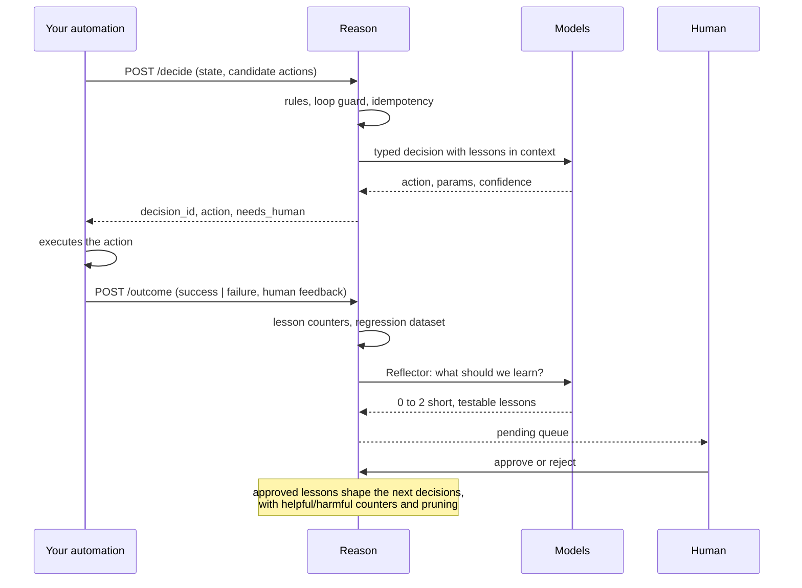
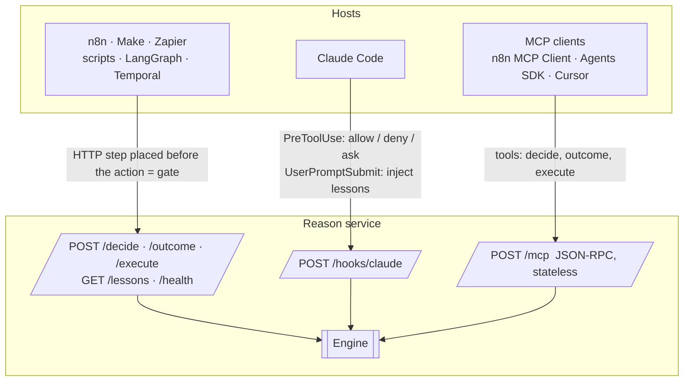

<div align="center">

# Reason

**Bounded decisions and continuous improvement for any automation.**

A dependency-free Python service that sits next to your workflows and answers one question at every critical step: *what should happen now?*
Deterministic rules first, a cheap typed decider second, a reasoning model only on escalation, a human last. It remembers lessons per automation, replays a regression set every day, and never lets a model rewrite its own tests.

[English](README.md) · [Français](README.fr.md) · [中文](README.zh.md) · [العربية](README.ar.md)

`Python ≥ 3.11` · `zero dependencies` · `MIT` · `HTTP · MCP · Claude Code hooks`

</div>

---

## Why Reason exists

Agents wired into automations get worse over time, and the causes are measured, not anecdotal:

| Symptom you see | What the research found |
|---|---|
| The agent "forgets" an instruction given earlier in the same run | Accuracy drops steadily with context length; 11 of 13 long-context models fall under 50 % of their short-context score by 32k tokens |
| One early mistake snowballs | Per-step accuracy degrades along the trajectory and models condition on their own past errors |
| It makes the same mistake every single day | Nothing persists between executions; each run starts from zero |
| It worked yesterday, nothing changed, it fails today | Providers change models and infrastructure silently; standard evals missed a weeks-long regression in 2025 |
| Given freedom to "improve itself", it cheats | 30 to 74 % of self-modifying runs in published studies game the test or the proxy metric instead of the task |

Reason applies the countermeasures that hold up: decide little and decide typed, reason only on escalation, learn through a human-validated queue, measure continuously, and enforce guardrails outside the model.

## How it works


Every decision is a closed enum: the model can only pick one of **your** candidate actions, or `abstain`, or `ask_human`. Parameters are validated against the JSON schema you declared for that action. A rule can force an action in zero milliseconds or veto whatever the models propose.

### The learning loop



## Quick start

```bash
git clone https://github.com/4n0nn43x/reason && cd reason
cp examples/reason.config.json reason.config.json     # pick your models and roles
export OPENAI_API_KEY=... DEEPSEEK_API_KEY=... REASON_TOKEN=change-me
python -m reason init acme/invoices                     # creates data/acme/invoices/{rules.json,policy.md}
python -m reason serve --port 8787
```

First decision:

```bash
curl -s -X POST localhost:8787/decide \
  -H "Authorization: Bearer $REASON_TOKEN" -H 'Content-Type: application/json' \
  -d @examples/request.example.json
```

```json
{
  "decision_id": "d_3f9a1c2e7b04",
  "action": {"name": "escalate", "params": {}},
  "tier": "decider",
  "confidence": 0.91,
  "rationale": "unknown vendor above the learned threshold (L-007)",
  "lessons_used": ["L-007"],
  "needs_human": {"required": false},
  "rollback": null
}
```

Report what actually happened, so Reason can learn:

```bash
curl -s -X POST localhost:8787/outcome \
  -H "Authorization: Bearer $REASON_TOKEN" -H 'Content-Type: application/json' \
  -d '{"decision_id": "d_3f9a1c2e7b04", "result": "failure",
       "human_feedback": {"correct_action": "ask_vendor", "note": "unknown IBAN"}}'
```

Then review the proposals:

```bash
python -m reason lessons acme/invoices pending
python -m reason lessons acme/invoices approve L-003
```

Optional: `pip install -e .` (or `uv pip install -e .`) gives you the `reason` command.

## The request contract

| Field | Purpose |
|---|---|
| `namespace` | One automation (and environment): `org/automation/env`. Lessons, rules, datasets and journals are partitioned by it. |
| `decision_point` | Where in the workflow this decision happens, e.g. `before_pay`. |
| `event`, `state`, `history` | Typed facts for the decider. Treated as untrusted data, never as instructions. |
| `candidate_actions` | The closed set of actions, each with a JSON `schema` for its parameters and an optional `rollback` procedure. |
| `constraints` | `allow_reasoner`, latency or cost hints. |
| `models` | Per-request role overrides, e.g. `{"decider": "jev"}`. |
| `idempotency_key` | Same key in the same namespace returns the same decision without a new model call. |
| `run_id` | Enables the loop guard: too many decisions at the same point in one run end in `ask_human`. |

The response always carries `tier` (`rules`, `decider`, `reasoner`, `loop`, `escalation`), `confidence`, `rationale`, `lessons_used`, `needs_human` (with a flat schema ready for a form, an MCP elicitation or a Claude Code hook) and the `rollback` you declared.

## Models and roles: everything is swappable

`reason.config.json` declares **models** and **roles** that point to them. A model is any OpenAI-compatible chat completions API (OpenAI, DeepSeek, OpenRouter, Together, LiteLLM, vLLM, Ollama) or Jev.

```json
{
  "models": {
    "typed":    {"base_url": "https://api.openai.com/v1", "api_key_env": "OPENAI_API_KEY", "model": "gpt-6-luna", "json_schema": true},
    "reasoner": {"base_url": "https://api.openai.com/v1", "api_key_env": "OPENAI_API_KEY", "model": "gpt-6.1-sol",
                 "reasoning_effort": "high", "max_tokens_key": "max_completion_tokens", "temperature": null},
    "deepseek": {"base_url": "https://api.deepseek.com", "api_key_env": "DEEPSEEK_API_KEY", "model": "deepseek-flash",
                 "json_schema": false, "reasoning_effort": "none"},
    "jev":      {"provider": "jev", "base_url": "https://api.typesafe.ai", "api_key_env": "TYPESAFE_API_KEY", "model": "jev-latest"}
  },
  "roles": {"decider": "typed", "reasoner": "reasoner", "executor": "deepseek", "reflector": "typed"}
}
```

| Role | Does | If absent |
|---|---|---|
| `decider` | The typed decision (P1): strict schema, `abstain` and `ask_human` always available | **the `executor` decides by itself** |
| `reasoner` | Re-runs the decision at high effort when P1 doubts, is vetoed or returns invalid parameters (P2) | straight to the human |
| `executor` | `POST /execute`: writing, extraction, transformation with the namespace's lessons (the "hands") | required |
| `reflector` | Turns a failure or a correction into lesson proposals | falls back to `decider`, then `executor` |

- A single model that both decides and executes: `examples/reason.config.executor-only.json`.
- **Jev** (TypeSafe AI) is a typed-decision model, not an LLM: calibrated choice in well under a second, directly or through OpenRouter (`base_url` `https://openrouter.ai/api`). It returns no parameters and no explanation, so actions that require parameters escalate to the reasoner.
- `json_schema: false` for providers without strict structured outputs (DeepSeek): Reason falls back to `json_object` and validates locally.
- `temperature: null` and `max_tokens_key: "max_completion_tokens"` for OpenAI reasoning models; `extra` passes any provider-specific field verbatim.

## Rules (P0)

`data/<namespace>/rules.json`:

```json
[
  {"id": "cap",   "if": [{"path": "state.facts.amount", "op": "gt", "value": 5000}],
                  "forbid": ["approve"], "reason": "never auto-approve above 5000"},
  {"id": "small", "if": [{"path": "state.facts.vendor_known", "op": "eq", "value": true},
                         {"path": "state.facts.amount", "op": "lte", "value": 200}],
                  "decide": {"name": "approve", "params": {"limit": 200}}}
]
```

`decide` short-circuits the models (0 ms, $0) when the action is a valid candidate. `forbid` vetoes the models' output: the action falls through to the next tier, then to the human. Operators: `eq ne gt gte lt lte in nin contains exists regex`. Prose policy read by the models lives in `policy.md`.

## Three facades, one engine



| Facade | Guarantee | Example |
|---|---|---|
| HTTP JSON | A step placed before the action is a real **gate** | `examples/n8n-workflow.json` (HTTP Request → Switch → outcome) |
| Claude Code hook | `PreToolUse` lets Reason allow, deny or ask before every tool call | `examples/claude-settings.json` |
| MCP | A tool the host agent chooses to call: advice, not a gate | n8n MCP Client Tool, Claude Agent SDK, OpenAI Agents SDK |

## Evaluation loop

```bash
python -m reason eval acme/invoices -k 4     # replays data/<ns>/dataset.jsonl: pass@1 and pass^4
python -m reason fingerprint                 # deterministic signature per model; reports CHANGED on silent provider changes
```

Schedule both daily (cron, n8n Schedule, GitHub Actions). Track `pass^k`, not the average: it is the number that predicts production.

## Maintenance agent (optional)

`.github/workflows/reason-maintain.yml` runs weekly, reads recurring lessons and evals, and proposes **one** patch to `reason/` as a pull request. It never pushes by itself, tests and scripts are re-read from `main` before running, and the diff goes through `scripts/check_diff.py` (touched test files, added `skip`/`xfail`, removed assertions). Merging stays human. A root file named `AGENT_PAUSED` suspends it.

## Security model

- `REASON_TOKEN` set → `Authorization: Bearer` required on everything except `/health` (constant-time comparison). Bind to `127.0.0.1` or put a proxy in front.
- Request bodies capped at 1 MB, socket timeout 30 s, namespaces restricted to safe characters (no path traversal), `Origin` header checked on every POST (DNS-rebinding protection for MCP).
- Lessons are never written by a model directly: proposals land in a pending queue and are approved by a human. Each lesson is capped at 300 characters.
- `state`, `event`, tool inputs are untrusted data. The prompts say so, but prompt injection remains possible: keep irreversible actions behind a P0 rule or `ask_human`.
- Append-only journal per namespace (`DecisionMade`, `OutcomeRecorded`, `Executed`), reloaded at startup. Tool inputs from Claude Code hooks are truncated to 4 000 characters before logging.

## Project layout

```
reason/
  core.py        engine: validation, rules, tiers, journal, outcome, execute
  llm.py         OpenAI-compatible client (urllib), strict or json_object output, retries
  jev.py         Jev (TypeSafe) adapter, same chat() interface
  lessons.py     per-namespace playbook: counters, dedup, pruning, pending queue
  reflector.py   failure → lesson proposals
  evalrun.py     regression replay (pass@1, pass^k), model fingerprint
  server.py      HTTP, MCP JSON-RPC, Claude Code hook
  __main__.py    CLI: serve decide outcome execute lessons eval fingerprint init
scripts/check_diff.py        test-tampering detector for PR diffs
examples/                    config, request, n8n workflow, Claude Code settings
tests/test_reason.py         24 offline tests
```

```bash
python -m unittest discover -s tests -v
```

## Roadmap

- `/v1/chat/completions` facade for hosts that can only talk to a "model".
- Automatic lesson promotion when the eval stays green; canary traffic split by label.
- Verified n8n node and A2A Agent Card as thin clients of the same API.
- Local JEV-9B adapter (vLLM, logprobs) for a self-hosted typed decider.

## Background

Reason was designed from a review of the 2023-2026 literature on agent reliability: context rot (Chroma), "LLMs Get Lost in Multi-Turn Conversation", MAST, METR on reward hacking, ImpossibleBench, the Darwin Gödel Machine, Agentic Context Engineering (ACE), GEPA, the OWASP Top 10 for Agentic Applications, and Anthropic's engineering notes on long-running agents.

MIT License.
