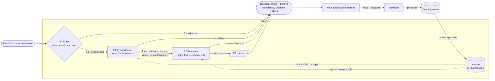
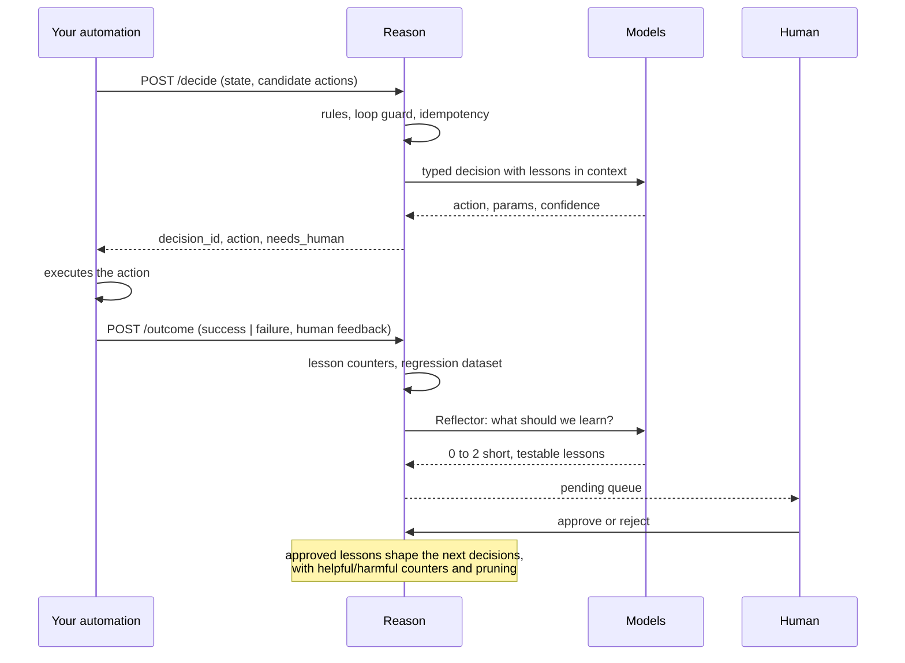
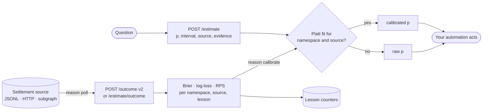
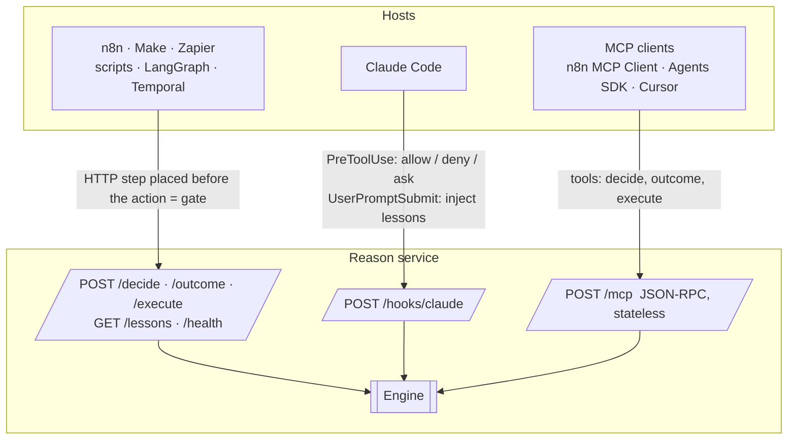

<div align="center">

# Reason

**Bounded decisions and continuous improvement for any automation.**

A dependency-free Python service that sits next to your workflows and answers one question at every critical step: *what should happen now?*
Deterministic rules first, a cheap typed decider second, a reasoning model only on escalation, a human last. It remembers lessons per automation, replays a regression set every day, and never lets a model rewrite its own tests.

[English](README.md) · [Français](README.fr.md) · [中文](README.zh.md) · [العربية](README.ar.md)

`Python ≥ 3.11` · `zero dependencies` · `MIT` · `HTTP · MCP · Claude Code hooks`

Release notes and version history: [CHANGELOG.md](CHANGELOG.md).

</div>

---

## Why Reason exists

Agents wired into automations get worse over time, and the causes are measured, not anecdotal:

| Symptom you see | What the research found |
|---|---|
| The agent "forgets" an instruction given earlier in the same run | Accuracy drops steadily with context length; 11 of 13 long-context models fall under 50 % of their short-context score by 32k tokens |
| One early mistake snowballs | Per-step accuracy degrades along the trajectory and models condition on their own past errors |
| It makes the same mistake every single day | Nothing persists between executions; each run starts from zero |
| It worked yesterday, nothing changed, it fails today | Providers change models and infrastructure silently; standard evals missed a weeks-long regression in 2025 |
| Given freedom to "improve itself", it cheats | 30 to 74 % of self-modifying runs in published studies game the test or the proxy metric instead of the task |

Sources: [NoLiMa, ICML 2025](https://proceedings.mlr.press/v267/modarressi25a.html) · [Sinha et al., ICLR 2026](https://arxiv.org/abs/2509.09677) · [Anthropic, long-running agents](https://www.anthropic.com/engineering/effective-harnesses-for-long-running-agents) · [Anthropic postmortem, Sept. 2025](https://www.anthropic.com/engineering/a-postmortem-of-three-recent-issues) · [METR, reward hacking](https://metr.org/blog/2025-06-05-recent-reward-hacking/) · [Reward Hacking in Self-Improving Code Agents, ICLR 2026 workshop](https://iclr.cc/virtual/2026/10018648)

Reason applies the countermeasures that hold up: decide little and decide typed, reason only on escalation, learn through a human-validated queue, measure continuously, and enforce guardrails outside the model.

## How it works



Every decision is a closed enum: the model can only pick one of **your** candidate actions, or `abstain`, or `ask_human`. Parameters are validated against the JSON schema you declared for that action. A rule can force an action in zero milliseconds or veto whatever the models propose.

### The learning loop



## Quick start

```bash
git clone https://github.com/4n0nn43x/reason && cd reason
cp examples/reason.config.json reason.config.json     # pick your models and roles
export OPENAI_API_KEY=... DEEPSEEK_API_KEY=... REASON_TOKEN=change-me
python -m reason init acme/invoices                     # creates data/acme/invoices/{rules.json,policy.md}
python -m reason serve --port 8787
```

First decision:

```bash
curl -s -X POST localhost:8787/decide \
  -H "Authorization: Bearer $REASON_TOKEN" -H 'Content-Type: application/json' \
  -d @examples/request.example.json
```

```json
{
  "decision_id": "d_3f9a1c2e7b04",
  "action": {"name": "escalate", "params": {}},
  "tier": "decider",
  "confidence": 0.91,
  "rationale": "unknown vendor above the learned threshold (L-007)",
  "lessons_used": ["L-007"],
  "needs_human": {"required": false},
  "rollback": null
}
```

Report what actually happened, so Reason can learn:

```bash
curl -s -X POST localhost:8787/outcome \
  -H "Authorization: Bearer $REASON_TOKEN" -H 'Content-Type: application/json' \
  -d '{"decision_id": "d_3f9a1c2e7b04", "result": "failure",
       "human_feedback": {"correct_action": "ask_vendor", "note": "unknown IBAN"}}'
```

Then review the proposals:

```bash
python -m reason lessons acme/invoices pending
python -m reason lessons acme/invoices approve L-003
```

Optional: `pip install -e .` (or `uv pip install -e .`) gives you the `reason` command.

## The request contract

| Field | Purpose |
|---|---|
| `namespace` | One automation (and environment): `org/automation/env`. Lessons, rules, datasets and journals are partitioned by it. |
| `decision_point` | Where in the workflow this decision happens, e.g. `before_pay`. |
| `event`, `state`, `history` | Typed facts for the decider. Treated as untrusted data, never as instructions. |
| `candidate_actions` | The closed set of actions, each with a JSON `schema` for its parameters and an optional `rollback` procedure. |
| `constraints` | `allow_reasoner`, latency or cost hints. |
| `models` | Per-request role overrides, e.g. `{"decider": "jev"}`. |
| `idempotency_key` | Same key in the same namespace returns the same decision without a new model call. |
| `run_id` | Enables the loop guard: too many decisions at the same point in one run end in `ask_human`. |

The response always carries `tier` (`rules`, `decider`, `reasoner`, `loop`, `escalation`), `confidence`, `rationale`, `lessons_used`, `needs_human` (with a flat schema ready for a form, an MCP elicitation or a Claude Code hook) and the `rollback` you declared.

## Models and roles: everything is swappable

`reason.config.json` declares **models** and **roles** that point to them. A model is any OpenAI-compatible chat completions API (OpenAI, DeepSeek, OpenRouter, Together, LiteLLM, vLLM, Ollama) or Jev.

```json
{
  "models": {
    "typed":    {"base_url": "https://api.openai.com/v1", "api_key_env": "OPENAI_API_KEY", "model": "gpt-6-luna", "json_schema": true},
    "reasoner": {"base_url": "https://api.openai.com/v1", "api_key_env": "OPENAI_API_KEY", "model": "gpt-6.1-sol",
                 "reasoning_effort": "high", "max_tokens_key": "max_completion_tokens", "temperature": null},
    "deepseek": {"base_url": "https://api.deepseek.com", "api_key_env": "DEEPSEEK_API_KEY", "model": "deepseek-flash",
                 "json_schema": false, "reasoning_effort": "none"},
    "jev":      {"provider": "jev", "base_url": "https://api.typesafe.ai", "api_key_env": "TYPESAFE_API_KEY", "model": "jev-latest"}
  },
  "roles": {"decider": "typed", "reasoner": "reasoner", "executor": "deepseek", "reflector": "typed"}
}
```

| Role | Does | If absent |
|---|---|---|
| `decider` | The typed decision (P1): strict schema, `abstain` and `ask_human` always available | **the `executor` decides by itself** |
| `reasoner` | Re-runs the decision at high effort when P1 doubts, is vetoed or returns invalid parameters (P2) | straight to the human |
| `executor` | `POST /execute`: writing, extraction, transformation with the namespace's lessons (the "hands") | required |
| `reflector` | Turns a failure or a correction into lesson proposals | falls back to `decider`, then `executor` |

- A single model that both decides and executes: `examples/reason.config.executor-only.json`.
- **Jev** (TypeSafe AI) is a typed-decision model, not an LLM: calibrated choice in well under a second, directly or through OpenRouter (`base_url` `https://openrouter.ai/api`). It returns no parameters and no explanation, so actions that require parameters escalate to the reasoner.
- `json_schema: false` for providers without strict structured outputs (DeepSeek): Reason falls back to `json_object` and validates locally.
- `temperature: null` and `max_tokens_key: "max_completion_tokens"` for OpenAI reasoning models; `extra` passes any provider-specific field verbatim.

## Rules (P0)

`data/<namespace>/rules.json`:

```json
[
  {"id": "cap",   "if": [{"path": "state.facts.amount", "op": "gt", "value": 5000}],
                  "forbid": ["approve"], "reason": "never auto-approve above 5000"},
  {"id": "small", "if": [{"path": "state.facts.vendor_known", "op": "eq", "value": true},
                         {"path": "state.facts.amount", "op": "lte", "value": 200}],
                  "decide": {"name": "approve", "params": {"limit": 200}}}
]
```

`decide` short-circuits the models (0 ms, $0) when the action is a valid candidate. `forbid` vetoes the models' output: the action falls through to the next tier, then to the human. Operators: `eq ne gt gte lt lte in nin contains exists regex`. Prose policy read by the models lives in `policy.md`.

## Scored estimates, deferred outcomes, rules and lessons

Beyond *which action*, Reason can answer *how likely*, and grade that answer when reality settles. Everything in this section is optional.



### Typed estimates

```bash
curl -s -X POST localhost:8787/estimate -H "Authorization: Bearer $REASON_TOKEN" -H 'Content-Type: application/json' \
  -d '{"namespace": "trader/delphi", "question": "Will X win the primary?", "kind": "binary",
       "market_price": 0.62, "resolves_at": "2026-11-04T06:00:00Z", "n_samples": 3}'
```

`kind` is `binary` (p and a 90 % interval), `categorical` or `ordinal` (a distribution that must sum to 1), or `quantity` (q05, q50, q95). Every estimate carries `source` (`fact` read from a dated primary source, `model` from a reproducible calculation, `opinion` otherwise), `evidence[]`, an optional `base_rate`, the lessons it used, and both `raw` and `calibrated` values. With `n_samples > 1` the samples are averaged in log-odds space and their spread becomes the interval.

When the question settles, `POST /estimate/outcome` scores it: Brier and log-loss (raw and calibrated), Brier of the base rate and of the market price as references, RPS for ordinal outcomes, absolute error and interval coverage for quantities. Lessons used by the estimate are credited from the score.

```bash
python -m reason calibrate trader/delphi            # per source: Brier, skill vs base rate and market, Murphy decomposition
python -m reason calibrate trader/delphi --fit      # learns Platt per source on a 70/30 time split, keeps it only if the test Brier improves
python -m reason calibrate trader/delphi --counterfactual   # re-runs each resolved estimate without each lesson: the causal measure
```

Murphy's decomposition (Brier = reliability - resolution + uncertainty) separates **calibration** (reliability) from **discrimination** (resolution). Reason never optimizes ECE, which is not a proper score. The estimate never decides a size: thresholds, abstention and position sizing belong to deterministic code outside Reason.

### Deferred outcomes and the poller

`POST /outcome` now accepts settlements that arrive weeks later and change their mind:

```json
{"decision_id": "d_3f9a…", "result": "no_outcome", "result_detail": "no_outcome", "payout_fraction": 0.12,
 "value": -3.4, "settled_at": "2026-10-03T14:02:11Z", "source": "delphi_subgraph", "source_ref": "0xabc…:17",
 "label_confidence": 1.0, "version": 1, "resolution_text": "…untrusted third-party text…"}
```

`result` adds `partial`, `void` and `no_outcome`; they map to `success`, `failure` or `unknown` for lesson counters (an unknown outcome is neither a reward nor a penalty). `source_ref` makes posting idempotent; a higher `version` revises an outcome and undoes the previous version's effect on lessons. Low `label_confidence` outcomes are recorded but do not move counters. Every settled decision gets a markdown post-mortem (thesis, what happened with the resolution text quoted, gap, proposed lessons), rewritten with a version history on revision.

```bash
python -m reason poll            # one pass over every configured source
python -m reason poll --loop     # every 5 minutes
python -m reason outcomes trader/delphi --horizon-hours 48   # success rate on the mature cohort, label coverage, poller lag
```

The poller reads a local JSONL, an HTTP JSON endpoint or a GraphQL subgraph from a persisted watermark, maps fields through config, matches each settlement to pending decisions by the `correlation_key` you passed at decision time and a time window, and marks decisions past their horizon as `unknown`. An event type that is neither a valid result, nor in `result_map`, nor in `ignore` is **never** turned into `unknown`: that would silently drop losses from the score and make every source look good. It is held, counted under `unmapped` in the tick report, warned about, and reprocessed once the config is fixed. See `examples/reason.config.v02.json` for a trader's `events.jsonl` and Polymarket's resolutions API.

### Rules v2

```json
{"id": "window-closes-before-event",
 "if": [{"path": "state.facts.window_end", "op": "before", "path2": "state.facts.event_at"}],
 "decide": {"name": "ask_human"},
 "reason": "Resolution window closes ({state.facts.window_end}) before the event ({state.facts.event_at})"}
```

Conditions compare a path to a value or to another path (`path2`), nest with `all`, `any` and `not`, and include date operators (`before`, `after`, `hours_until_gte`, `hours_until_lte`, `within_hours`). Time comes from `now` in the request, filled at reception if absent and copied into the decision, so every evaluation is replayable. `regex` works on untrusted text such as `ruling_text`: patterns are written by the rule author only, capped at 200 characters, linted against nested quantifiers, applied to truncated and optionally normalized text, and the matched clause can be quoted with `{match}`. A forced `decide` is now checked against `forbid`.

```bash
python -m reason rules trader/delphi lint
python -m reason rules trader/delphi test --cases examples/rules.test.example.json   # pass/fail, never-matched rules, contradictions
```

### Lessons with scope, expiry and a markdown vault

Lessons now carry `tags`, `decision_points`, `valid_from`, `valid_until`, a `status` and their provenance. Injection filters by status, validity window and scope, sorts by the Wilson lower bound of helpful/harmful, and stops at 6 lessons. `python -m reason lessons <ns> review` lists promotion candidates (to become P0 rules through a human PR) and lessons to review.

Set `vault_dir` and Reason reads lessons from an Obsidian vault or a git repository:

```markdown
---
id: V-012
kind: lesson
namespace: trader/delphi
tags: [sport]
decision_points: [before_bet]
valid_until: 2026-12-31
author: human
---
Pre-match odds go stale at kick-off.
```

Files in `doctrine/` are approved, files in `postmortems/` are pending, unless `status:` says otherwise. Lessons without provenance are quarantined, duplicate ids are ignored and reported, expired lessons drop out on their own. Approving in Obsidian (edit `status:` or move the file) takes effect at the next decision. Reason writes new proposals as new files and **never modifies an existing vault file**; counters stay in Reason's own data.

## Three facades, one engine



| Facade | Guarantee | Example |
|---|---|---|
| HTTP JSON | A step placed before the action is a real **gate** | `examples/n8n-workflow.json` (HTTP Request → Switch → outcome) |
| Claude Code hook | `PreToolUse` lets Reason allow, deny or ask before every tool call | `examples/claude-settings.json` |
| MCP | A tool the host agent chooses to call: advice, not a gate | n8n MCP Client Tool, Claude Agent SDK, OpenAI Agents SDK |

## Evaluation loop

```bash
python -m reason eval acme/invoices -k 4     # replays data/<ns>/dataset.jsonl: pass@1 and pass^4
python -m reason fingerprint                 # deterministic signature per model; reports CHANGED on silent provider changes
```

Schedule both daily (cron, n8n Schedule, GitHub Actions). Track `pass^k`, not the average: it is the number that predicts production.

## No self-modifying agent

Reason ships no agent that modifies its own code or tests: a model that can edit what grades it will game the grade. `scripts/check_diff.py` is a standalone CI check that flags touched test files, added `skip`/`xfail` markers and removed assertions in any pull request.
## Proving it works

A valid JSON decision is not a correct one, and a model's self-reported confidence is not calibrated. Reason measures instead of asserting.

**Calibrated decision confidence.** Every outcome on a model-made decision is recorded as (confidence, correct) in `decision_scores.jsonl`. Then:

```bash
python -m reason calibrate acme/invoices --decisions --target-accuracy 0.9
```

fits Platt scaling per tier (kept only if it improves a held-out time split), reports AUROC (does confidence separate right from wrong at all?) and AURC (area under the risk-coverage curve), and learns an escalation threshold per decision point on the older 70 % of outcomes: the lowest calibrated confidence whose Wilson lower bound reaches the target accuracy. Coverage and accuracy at that threshold are then reported on the recent 30 %, which the fit never saw. A learned threshold never goes below the configured one (unless `allow_threshold_below_default`) and expires after `calibration_max_age_days`. Proposals that were escalated are still scored when a human answers, so a threshold can come back down. Decisions then carry `confidence` (calibrated), `confidence_raw`, `threshold` and `calibrated`.

**Sample agreement.** With `"decide": {"n_samples": 3}` (or `constraints.n_samples` per request), the decider is sampled several times; the majority action wins, its share of votes becomes `agreement` (divided by the samples requested, so a provider failure counts against it), and the effective confidence never exceeds the agreement. Deterministic deciders such as Jev are called once.

**Intent key for the executor.** Every executable decision carries `intent_key`, a stable hash of namespace, decision, action and parameters. Pass it as `client_order_id`, `Idempotency-Key` or `ClOrdID`: every resend of the order that comes from this decision carries the same key and the downstream system can deduplicate it. To get the same decision (hence the same key) back after a crash, send `idempotency_key` with the request. Reason's idempotency stops at the decision; your executor must reconcile with the broker or provider before resending.

**Lesson ablation on a held-out set.**

```bash
python -m reason eval acme/invoices --compare-lessons wrong_lessons.json --after 2026-10-01T00:00:00Z
```

replays the regression set three times on the same cases (lessons on, off, deliberately wrong), only on decisions made after the given date, and reports paired wins and losses with an exact sign test. Replays are dry runs: nothing is journaled. Every replay is appended to `trials.jsonl`, so the number of variants tried is known when judging a result.

Orders of magnitude to keep in mind: telling a 55 % hit rate from 50 % takes roughly 600 to 800 independent outcomes; 52 % from 50 %, about 4 000 to 6 600.

**Proof bench.**

```bash
python -m reason bench --namespace acme/invoices
```

runs the invariants at volume, with fixed seeds and no network, in about ten seconds: a hostile decider that always proposes the forbidden action or out-of-bounds parameters (rules), a gullible decider that obeys any instruction hidden in `event`, `state` or `history` (injection), a provider failing 10 % of the time with timeouts, 429s, non-JSON and wrong schemas (providers), 8 simultaneous requests per idempotency key (concurrency), `SIGKILL` at random points of a decision loop then restart on the same `data_dir` (crash), and a canary lesson plus 1 000 fuzzed namespace names (isolation). Each suite reports its failures and the 95 % upper bound on the failure rate (3 000 cases without a failure: under 0.1 %); the command exits with 1 on any failure. `--namespace` adds baselines on recorded outcomes (Reason against always escalating and against the majority action learned on the older 70 %), `--live N` measures how often the configured decider is hijacked by the injection payloads (at least 2 billed model calls per case, more with `n_samples` or a reasoner, in a throwaway `data_dir`).

## Security model

- `REASON_TOKEN` set → `Authorization: Bearer` required on everything except `/health` (constant-time comparison). Bind to `127.0.0.1` or put a proxy in front.
- Request bodies capped at 1 MB, socket timeout 30 s, namespaces restricted to safe characters (no path traversal), `Origin` header checked on every POST (DNS-rebinding protection for MCP).
- Lessons are never written by a model directly: proposals land in a pending queue and are approved by a human. Each lesson is capped at 300 characters.
- `state`, `event`, tool inputs are untrusted data. The prompts say so, but prompt injection remains possible: keep irreversible actions behind a P0 rule or `ask_human`.
- Append-only journal per namespace (`DecisionMade`, `OutcomeRecorded`, `Executed`), reloaded at startup. Tool inputs from Claude Code hooks are truncated to 4 000 characters before logging.
- the server refuses to start without authentication (`serve --insecure` is allowed on a loopback address only). Besides the admin `REASON_TOKEN`, `config.tokens` maps secrets to namespaces (glob patterns) and scopes (`decide`, `outcome`, `execute`, `estimate`, `read`), checked on HTTP, MCP and hooks. One `reason serve` per `data_dir` (file lock). Playbook writes and journal appends are file-locked across processes.
- `redact_paths` (for example `state.facts.iban`, limited to `event`, `state`, `history`, `context`, `ruling_text`, `input`) masks sensitive fields in everything persisted (journal, datasets, scores) while the model still sees the full request; free text such as a model rationale is not masked; `reason prune <ns> --days N` removes old journal events except decisions still awaiting an outcome.

## Project layout

```
reason/
  llm.py         OpenAI-compatible client (urllib), strict or json_object output, retries
  jev.py         Jev (TypeSafe) adapter, same chat() interface
  lessons.py     per-namespace playbook: counters, dedup, pruning, pending queue
  reflector.py   failure → lesson proposals
  bench.py       proof bench: rules, injection, providers, concurrency, crash, isolation, baselines
  evalrun.py     regression replay (pass@1, pass^k), model fingerprint
  server.py      HTTP, MCP JSON-RPC, Claude Code hook
  core.py        engine: validation, tiers, journal, outcome v2, post-mortems, estimate, execute
  rules.py       P0 rules v2: path2, all/any/not, date operators, bounded regex, interpolation, rule tests
  calib.py       Brier, log-loss, RPS, Murphy decomposition, Platt, Wilson, bootstrap (stdlib)
  poller.py      deferred outcomes: JSONL / HTTP / GraphQL sources, watermark, matching, horizon
  vault.py       markdown vault: frontmatter lessons, proposals, post-mortems (never rewrites existing files)
  __main__.py    CLI: serve decide outcome execute estimate estimate-outcome lessons rules eval outcomes calibrate poll pending fingerprint bench init
scripts/check_diff.py        test-tampering detector for PR diffs
examples/                    configs, request, rules v2 and their test cases, n8n workflow, Claude Code settings
tests/test_reason.py         60 offline tests
```

```bash
python -m unittest discover -s tests -v
```

## Roadmap

- `/v1/chat/completions` facade for hosts that can only talk to a "model".
- Automatic lesson promotion when the eval stays green; canary traffic split by label.
- Verified n8n node and A2A Agent Card as thin clients of the same API.
- Local JEV-9B adapter (vLLM, logprobs) for a self-hosted typed decider.

## Background

Reason was designed from a review of the 2023-2026 literature on agent reliability: context rot (Chroma), "LLMs Get Lost in Multi-Turn Conversation", MAST, METR on reward hacking, ImpossibleBench, the Darwin Gödel Machine, Agentic Context Engineering (ACE), GEPA, the OWASP Top 10 for Agentic Applications, and Anthropic's engineering notes on long-running agents.

MIT License.
