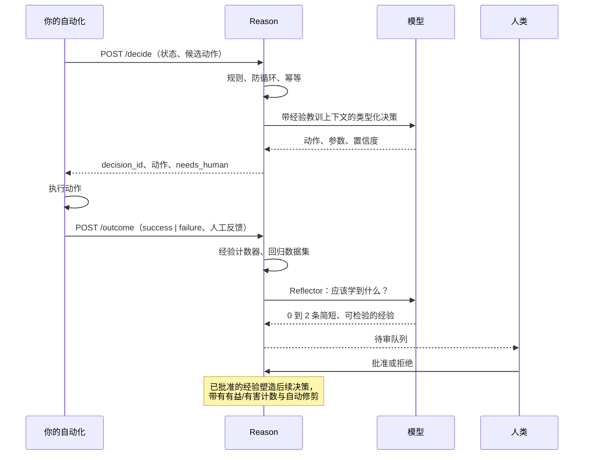
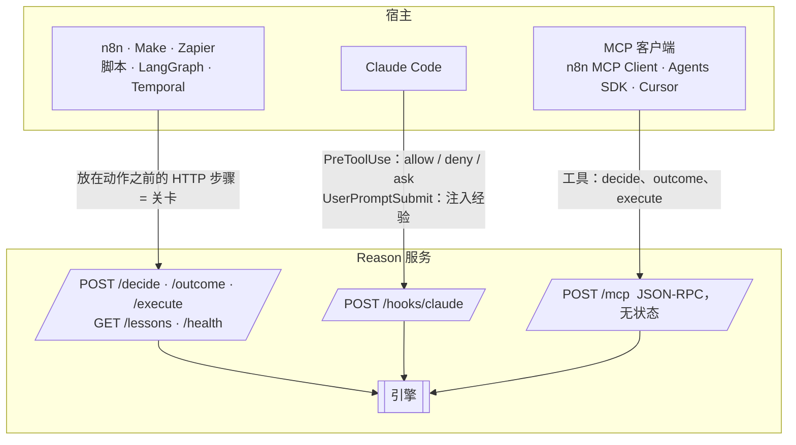

<div align="center">

# Reason

**为任何自动化流程提供有边界的决策与持续改进。**

一个零依赖的 Python 服务，部署在你的工作流旁边，在每个关键步骤只回答一个问题：*现在应该发生什么？*
先走确定性规则，再走廉价的类型化决策器，只有在升级时才动用推理模型，最后才交给人类。它按自动化流程记住经验教训，每天回放回归测试集，并且绝不允许模型改写自己的测试。

[English](README.md) · [Français](README.fr.md) · [中文](README.zh.md) · [العربية](README.ar.md)

`Python ≥ 3.11` · `零依赖` · `MIT` · `HTTP · MCP · Claude Code 钩子`

</div>

---

## 为什么需要 Reason

接入自动化流程的智能体会随时间变差，而且原因是有实测数据的，不是传闻：

| 你看到的症状 | 研究结论 |
|---|---|
| 智能体"忘记"了同一次运行中早先给出的指令 | 准确率随上下文长度稳步下降；13 个长上下文模型中有 11 个在 32k token 时跌到短上下文得分的 50 % 以下 |
| 一个早期错误滚雪球 | 每一步的准确率沿轨迹逐步退化，模型会以自己过去的错误为条件继续出错 |
| 每天都犯同样的错 | 两次执行之间什么都不保留，每次运行都从零开始 |
| 昨天还好好的，什么都没改，今天就失败 | 供应商会静默更换模型和基础设施；2025 年标准评测漏掉了一次持续数周的回归 |
| 一旦获得"自我改进"的自由，它就作弊 | 已发表研究中 30 % 到 74 % 的自我修改运行是在钻测试或代理指标的空子，而不是解决任务 |

Reason 采用经得起检验的对策：少决策、决策类型化，只在升级时推理，通过人工审核队列学习，持续度量，并把护栏放在模型之外执行。

## 工作原理


每个决策都是封闭枚举：模型只能从**你的**候选动作中选一个，或者 `abstain`，或者 `ask_human`。参数会按你为该动作声明的 JSON schema 校验。规则可以在零毫秒内强制一个动作，也可以否决模型提出的任何动作。

### 学习闭环



## 快速开始

```bash
git clone https://github.com/4n0nn43x/reason && cd reason
cp examples/reason.config.json reason.config.json     # 选择你的模型和角色
export OPENAI_API_KEY=... DEEPSEEK_API_KEY=... REASON_TOKEN=change-me
python -m reason init acme/invoices                     # 创建 data/acme/invoices/{rules.json,policy.md}
python -m reason serve --port 8787
```

第一个决策：

```bash
curl -s -X POST localhost:8787/decide \
  -H "Authorization: Bearer $REASON_TOKEN" -H 'Content-Type: application/json' \
  -d @examples/request.example.json
```

```json
{
  "decision_id": "d_3f9a1c2e7b04",
  "action": {"name": "escalate", "params": {}},
  "tier": "decider",
  "confidence": 0.91,
  "rationale": "未知供应商，金额高于已学习阈值 (L-007)",
  "lessons_used": ["L-007"],
  "needs_human": {"required": false},
  "rollback": null
}
```

回报实际发生的结果，让 Reason 学习：

```bash
curl -s -X POST localhost:8787/outcome \
  -H "Authorization: Bearer $REASON_TOKEN" -H 'Content-Type: application/json' \
  -d '{"decision_id": "d_3f9a1c2e7b04", "result": "failure",
       "human_feedback": {"correct_action": "ask_vendor", "note": "未知 IBAN"}}'
```

然后审核提案：

```bash
python -m reason lessons acme/invoices pending
python -m reason lessons acme/invoices approve L-003
```

可选：`pip install -e .`（或 `uv pip install -e .`）安装 `reason` 命令。

## 请求契约

| 字段 | 用途 |
|---|---|
| `namespace` | 一个自动化流程（及环境）：`org/automation/env`。经验、规则、数据集和日志按它分区。 |
| `decision_point` | 决策在工作流中的位置，例如 `before_pay`。 |
| `event`、`state`、`history` | 给决策器的类型化事实。视为不可信数据，绝不视为指令。 |
| `candidate_actions` | 封闭的动作集合，每个动作带参数的 JSON `schema` 和可选的 `rollback` 流程。 |
| `constraints` | `allow_reasoner`、延迟或成本提示。 |
| `models` | 本次请求的角色覆盖，例如 `{"decider": "jev"}`。 |
| `idempotency_key` | 同一命名空间内相同的键返回相同决策，不再调用模型。 |
| `run_id` | 启用防循环：同一运行中同一位置的决策过多时以 `ask_human` 结束。 |

响应始终包含 `tier`（`rules`、`decider`、`reasoner`、`loop`、`escalation`）、`confidence`、`rationale`、`lessons_used`、`needs_human`（带可直接用于表单、MCP 引导或 Claude Code 钩子的扁平 schema）以及你声明的 `rollback`。

## 模型与角色：一切可替换

`reason.config.json` 声明**模型**和指向它们的**角色**。模型可以是任何兼容 OpenAI 的 chat completions API（OpenAI、DeepSeek、OpenRouter、Together、LiteLLM、vLLM、Ollama）或 Jev。

```json
{
  "models": {
    "typed":    {"base_url": "https://api.openai.com/v1", "api_key_env": "OPENAI_API_KEY", "model": "gpt-6-luna", "json_schema": true},
    "reasoner": {"base_url": "https://api.openai.com/v1", "api_key_env": "OPENAI_API_KEY", "model": "gpt-6.1-sol",
                 "reasoning_effort": "high", "max_tokens_key": "max_completion_tokens", "temperature": null},
    "deepseek": {"base_url": "https://api.deepseek.com", "api_key_env": "DEEPSEEK_API_KEY", "model": "deepseek-flash",
                 "json_schema": false, "reasoning_effort": "none"},
    "jev":      {"provider": "jev", "base_url": "https://api.typesafe.ai", "api_key_env": "TYPESAFE_API_KEY", "model": "jev-latest"}
  },
  "roles": {"decider": "typed", "reasoner": "reasoner", "executor": "deepseek", "reflector": "typed"}
}
```

| 角色 | 职责 | 缺省时 |
|---|---|---|
| `decider` | 类型化决策（P1）：严格 schema，`abstain` 和 `ask_human` 始终可选 | **由 `executor` 自行决策** |
| `reasoner` | 当 P1 犹豫、被否决或返回无效参数时，以高强度重新决策（P2） | 直接交给人类 |
| `executor` | `POST /execute`：携带命名空间经验的写作、抽取、转换（"双手"） | 必需 |
| `reflector` | 把失败或纠正转化为经验提案 | 回退到 `decider`，再到 `executor` |

- 单个模型既决策又执行：`examples/reason.config.executor-only.json`。
- **Jev**（TypeSafe AI）是类型化决策模型，不是 LLM：远低于一秒给出校准过的选择，可直连或经 OpenRouter（`base_url` 为 `https://openrouter.ai/api`）。它不返回参数也不解释，因此需要参数的动作会升级到推理器。
- 对没有严格结构化输出的供应商（DeepSeek）设 `json_schema: false`：Reason 退回 `json_object` 并在本地校验。
- OpenAI 推理模型用 `temperature: null` 与 `max_tokens_key: "max_completion_tokens"`；`extra` 原样透传任何供应商专有字段。

## 规则（P0）

`data/<namespace>/rules.json`：

```json
[
  {"id": "cap",   "if": [{"path": "state.facts.amount", "op": "gt", "value": 5000}],
                  "forbid": ["approve"], "reason": "超过 5000 绝不自动批准"},
  {"id": "small", "if": [{"path": "state.facts.vendor_known", "op": "eq", "value": true},
                         {"path": "state.facts.amount", "op": "lte", "value": 200}],
                  "decide": {"name": "approve", "params": {"limit": 200}}}
]
```

当动作是有效候选时，`decide` 直接绕过模型（0 毫秒，0 美元）。`forbid` 否决模型的输出：该动作落到下一层，再到人类。运算符：`eq ne gt gte lt lte in nin contains exists regex`。供模型阅读的自然语言策略放在 `policy.md`。

## 三个门面，一个引擎



| 门面 | 保证 | 示例 |
|---|---|---|
| HTTP JSON | 放在动作之前的步骤是真正的**关卡** | `examples/n8n-workflow.json`（HTTP Request → Switch → outcome） |
| Claude Code 钩子 | `PreToolUse` 让 Reason 在每次工具调用前允许、拒绝或询问 | `examples/claude-settings.json` |
| MCP | 宿主智能体自行选择调用的工具：是建议，不是关卡 | n8n MCP Client Tool、Claude Agent SDK、OpenAI Agents SDK |

## 评测闭环

```bash
python -m reason eval acme/invoices -k 4     # 回放 data/<ns>/dataset.jsonl：pass@1 与 pass^4
python -m reason fingerprint                 # 每个模型的确定性指纹；供应商静默变更时报告 CHANGED
```

两者都每天调度（cron、n8n Schedule、GitHub Actions）。关注 `pass^k` 而不是平均值：它才是预测生产表现的数字。

## 维护智能体（可选）

`.github/workflows/reason-maintain.yml` 每周运行，读取反复出现的经验和评测结果，以 pull request 的形式对 `reason/` 提出**一个**补丁。它从不自行推送，运行前会从 `main` 重新读取测试和脚本，diff 要经过 `scripts/check_diff.py`（改动的测试文件、新增的 `skip`/`xfail`、删除的断言）。合并仍由人工完成。根目录放一个 `AGENT_PAUSED` 文件即可暂停。

## 安全模型

- 设置了 `REASON_TOKEN` 后，除 `/health` 外一切请求都要求 `Authorization: Bearer`（常量时间比较）。绑定 `127.0.0.1` 或前置代理。
- 请求体上限 1 MB，套接字超时 30 秒，命名空间限制为安全字符（无路径穿越），每个 POST 都校验 `Origin` 头（MCP 的 DNS 重绑定防护）。
- 经验绝不由模型直接写入：提案进入待审队列，由人工批准。每条经验上限 300 字符。
- `state`、`event`、工具输入都是不可信数据。提示词会声明这一点，但提示注入仍然可能：把不可逆动作放在 P0 规则或 `ask_human` 之后。
- 每个命名空间有只追加的日志（`DecisionMade`、`OutcomeRecorded`、`Executed`），启动时重新加载。来自 Claude Code 钩子的工具输入在记录前截断到 4 000 字符。

## 项目结构

```
reason/
  core.py        引擎：校验、规则、层级、日志、outcome、execute
  llm.py         兼容 OpenAI 的客户端（urllib），严格或 json_object 输出，重试
  jev.py         Jev（TypeSafe）适配器，相同的 chat() 接口
  lessons.py     按命名空间的经验手册：计数器、去重、修剪、待审队列
  reflector.py   失败 → 经验提案
  evalrun.py     回归回放（pass@1、pass^k）、模型指纹
  server.py      HTTP、MCP JSON-RPC、Claude Code 钩子
  __main__.py    CLI：serve decide outcome execute lessons eval fingerprint init
scripts/check_diff.py        PR diff 的测试篡改检测器
examples/                    配置、请求、n8n 工作流、Claude Code 设置
tests/test_reason.py         24 个离线测试
```

```bash
python -m unittest discover -s tests -v
```

## 路线图

- `/v1/chat/completions` 门面，服务只会与"模型"对话的宿主。
- 评测保持通过时自动晋升经验；按标签做金丝雀流量分配。
- 经过验证的 n8n 节点和 A2A Agent Card，作为同一 API 的轻客户端。
- 本地 JEV-9B 适配器（vLLM、logprobs），自托管的类型化决策器。

## 背景

Reason 基于对 2023 至 2026 年智能体可靠性文献的综述设计：context rot（Chroma）、"LLMs Get Lost in Multi-Turn Conversation"、MAST、METR 关于 reward hacking 的研究、ImpossibleBench、Darwin Gödel Machine、Agentic Context Engineering（ACE）、GEPA、OWASP Top 10 for Agentic Applications，以及 Anthropic 关于长时运行智能体的工程笔记。

MIT 许可证。
