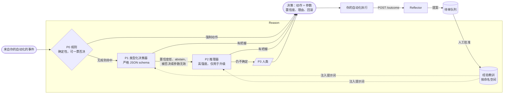
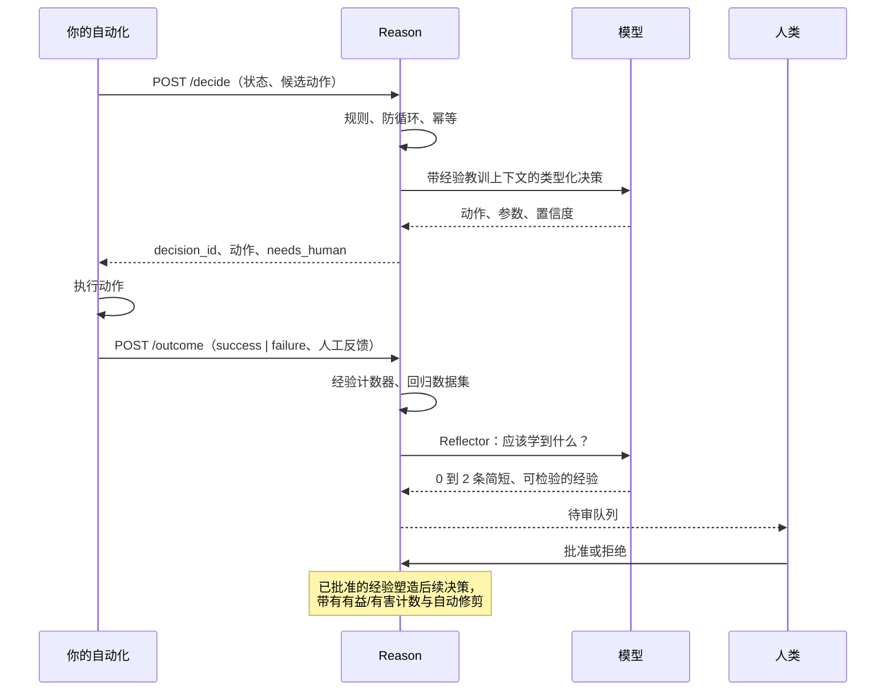
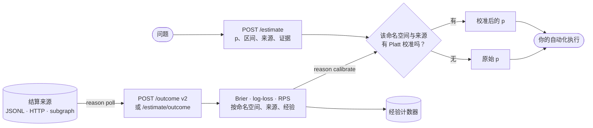
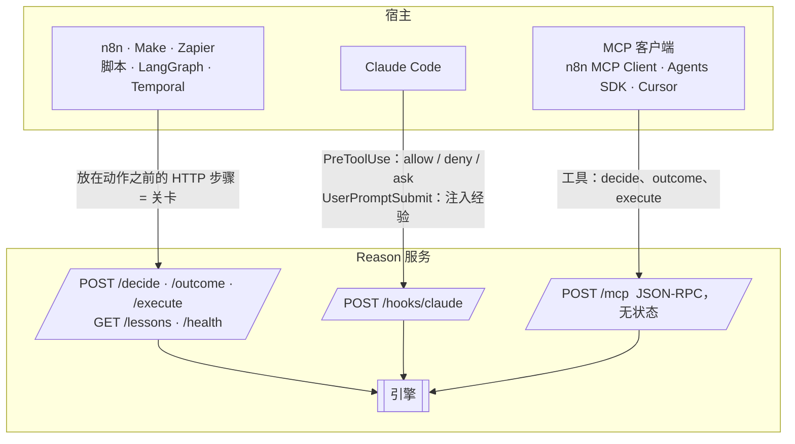

<div align="center">

# Reason

**为任何自动化流程提供有边界的决策与持续改进。**

一个零依赖的 Python 服务，部署在你的工作流旁边，在每个关键步骤只回答一个问题：*现在应该发生什么？*
先走确定性规则，再走廉价的类型化决策器，只有在升级时才动用推理模型，最后才交给人类。它按自动化流程记住经验教训，每天回放回归测试集，并且绝不允许模型改写自己的测试。

[English](README.md) · [Français](README.fr.md) · [中文](README.zh.md) · [العربية](README.ar.md)

`Python ≥ 3.11` · `零依赖` · `MIT` · `HTTP · MCP · Claude Code 钩子`

版本说明与历史：[CHANGELOG.md](CHANGELOG.md)。

</div>

---

## 为什么需要 Reason

接入自动化流程的智能体会随时间变差，而且原因是有实测数据的，不是传闻：

| 你看到的症状 | 研究结论 |
|---|---|
| 智能体"忘记"了同一次运行中早先给出的指令 | 准确率随上下文长度稳步下降；13 个长上下文模型中有 11 个在 32k token 时跌到短上下文得分的 50 % 以下 |
| 一个早期错误滚雪球 | 每一步的准确率沿轨迹逐步退化，模型会以自己过去的错误为条件继续出错 |
| 每天都犯同样的错 | 两次执行之间什么都不保留，每次运行都从零开始 |
| 昨天还好好的，什么都没改，今天就失败 | 供应商会静默更换模型和基础设施；2025 年标准评测漏掉了一次持续数周的回归 |
| 一旦获得"自我改进"的自由，它就作弊 | 已发表研究中 30 % 到 74 % 的自我修改运行是在钻测试或代理指标的空子，而不是解决任务 |

来源：[NoLiMa, ICML 2025](https://proceedings.mlr.press/v267/modarressi25a.html) · [Sinha 等, ICLR 2026](https://arxiv.org/abs/2509.09677) · [Anthropic，长时运行智能体](https://www.anthropic.com/engineering/effective-harnesses-for-long-running-agents) · [Anthropic 事故复盘，2025 年 9 月](https://www.anthropic.com/engineering/a-postmortem-of-three-recent-issues) · [METR，reward hacking](https://metr.org/blog/2025-06-05-recent-reward-hacking/) · [Reward Hacking in Self-Improving Code Agents，ICLR 2026 研讨会](https://iclr.cc/virtual/2026/10018648)

Reason 采用经得起检验的对策：少决策、决策类型化，只在升级时推理，通过人工审核队列学习，持续度量，并把护栏放在模型之外执行。

## 工作原理



每个决策都是封闭枚举：模型只能从**你的**候选动作中选一个，或者 `abstain`，或者 `ask_human`。参数会按你为该动作声明的 JSON schema 校验。规则可以在零毫秒内强制一个动作，也可以否决模型提出的任何动作。

### 学习闭环



## 快速开始

```bash
git clone https://github.com/4n0nn43x/reason && cd reason
cp examples/reason.config.json reason.config.json     # 选择你的模型和角色
export OPENAI_API_KEY=... DEEPSEEK_API_KEY=... REASON_TOKEN=change-me
python -m reason init acme/invoices                     # 创建 data/acme/invoices/{rules.json,policy.md}
python -m reason serve --port 8787
```

第一个决策：

```bash
curl -s -X POST localhost:8787/decide \
  -H "Authorization: Bearer $REASON_TOKEN" -H 'Content-Type: application/json' \
  -d @examples/request.example.json
```

```json
{
  "decision_id": "d_3f9a1c2e7b04",
  "action": {"name": "escalate", "params": {}},
  "tier": "decider",
  "confidence": 0.91,
  "rationale": "未知供应商，金额高于已学习阈值 (L-007)",
  "lessons_used": ["L-007"],
  "needs_human": {"required": false},
  "rollback": null
}
```

回报实际发生的结果，让 Reason 学习：

```bash
curl -s -X POST localhost:8787/outcome \
  -H "Authorization: Bearer $REASON_TOKEN" -H 'Content-Type: application/json' \
  -d '{"decision_id": "d_3f9a1c2e7b04", "result": "failure",
       "human_feedback": {"correct_action": "ask_vendor", "note": "未知 IBAN"}}'
```

然后审核提案：

```bash
python -m reason lessons acme/invoices pending
python -m reason lessons acme/invoices approve L-003
```

可选：`pip install -e .`（或 `uv pip install -e .`）安装 `reason` 命令。

## 请求契约

| 字段 | 用途 |
|---|---|
| `namespace` | 一个自动化流程（及环境）：`org/automation/env`。经验、规则、数据集和日志按它分区。 |
| `decision_point` | 决策在工作流中的位置，例如 `before_pay`。 |
| `event`、`state`、`history` | 给决策器的类型化事实。视为不可信数据，绝不视为指令。 |
| `candidate_actions` | 封闭的动作集合，每个动作带参数的 JSON `schema` 和可选的 `rollback` 流程。 |
| `constraints` | `allow_reasoner`、延迟或成本提示。 |
| `models` | 本次请求的角色覆盖，例如 `{"decider": "jev"}`。 |
| `idempotency_key` | 同一命名空间内相同的键返回相同决策，不再调用模型。 |
| `run_id` | 启用防循环：同一运行中同一位置的决策过多时以 `ask_human` 结束。 |

响应始终包含 `tier`（`rules`、`decider`、`reasoner`、`loop`、`escalation`）、`confidence`、`rationale`、`lessons_used`、`needs_human`（带可直接用于表单、MCP 引导或 Claude Code 钩子的扁平 schema）以及你声明的 `rollback`。

## 模型与角色：一切可替换

`reason.config.json` 声明**模型**和指向它们的**角色**。模型可以是任何兼容 OpenAI 的 chat completions API（OpenAI、DeepSeek、OpenRouter、Together、LiteLLM、vLLM、Ollama）、Anthropic Messages API（Claude，`"provider": "anthropic"`）或 Jev。没有任何一个是必需的，可自由组合。

```json
{
  "models": {
    "typed":    {"base_url": "https://api.openai.com/v1", "api_key_env": "OPENAI_API_KEY", "model": "gpt-6-luna", "json_schema": true},
    "reasoner": {"base_url": "https://api.openai.com/v1", "api_key_env": "OPENAI_API_KEY", "model": "gpt-6.1-sol",
                 "reasoning_effort": "high", "max_tokens_key": "max_completion_tokens", "temperature": null},
    "deepseek": {"base_url": "https://api.deepseek.com", "api_key_env": "DEEPSEEK_API_KEY", "model": "deepseek-flash",
                 "json_schema": false, "reasoning_effort": "none"},
    "jev":      {"provider": "jev", "base_url": "https://api.typesafe.ai", "api_key_env": "TYPESAFE_API_KEY", "model": "jev-latest"}
  },
  "roles": {"decider": "typed", "reasoner": "reasoner", "executor": "deepseek", "reflector": "typed"}
}
```

| 角色 | 职责 | 缺省时 |
|---|---|---|
| `decider` | 类型化决策（P1）：严格 schema，`abstain` 和 `ask_human` 始终可选 | **由 `executor` 自行决策** |
| `reasoner` | 当 P1 犹豫、被否决或返回无效参数时，以高强度重新决策（P2） | 直接交给人类 |
| `executor` | `POST /execute`：携带命名空间经验的写作、抽取、转换（"双手"） | 必需 |
| `reflector` | 把失败或纠正转化为经验提案 | 回退到 `decider`，再到 `executor` |

- 单个模型既决策又执行：`examples/reason.config.executor-only.json`。
- **Claude** 原生接入：`{"provider": "anthropic", "base_url": "https://api.anthropic.com/v1", "api_key_env": "ANTHROPIC_API_KEY", "model": "claude-opus-5-5", "reasoning_effort": "high"}`。`reasoning_effort` 映射为 `output_config.effort`（`low` 到 `max`），决策 schema 走结构化输出，从不发送 `temperature`，响应以流式读取，长生成不会超过 `timeout`（按每次读取计算）。任何角色都可使用。
- `"web": true` 启用供应商原生的联网搜索（`web_max_uses` 默认 5，限制搜索次数）：Claude 上为 `web_search` 工具，OpenRouter 上为 `web` 插件，其他兼容 OpenAI 的 API 上为 `web_search_options`（仅限搜索模型，其他模型会拒绝）。在 Claude 上，搜索引用与强制 JSON 输出互斥，因此 schema 写入提示词，输出在本地校验。此类模型的估计归入独立渠道 `web:<模型>`，单独计算 Brier，只有跑赢市场才保留。网页内容属于不可信输入；问题揭晓后，回放（`calibrate --counterfactual`、`eval`）可能在网上直接找到答案：不要让联网模型参与回放。
- **Jev**（TypeSafe AI）是可选的：只有当某个模型声明 `"provider": "jev"` 时才会加载。它是类型化决策模型，不是 LLM：远低于一秒给出校准过的选择，可直连或经 OpenRouter（`base_url` 为 `https://openrouter.ai/api`）。它不返回参数也不解释，因此需要参数的动作会升级到推理器。
- 对没有严格结构化输出的供应商（DeepSeek）设 `json_schema: false`：Reason 退回 `json_object` 并在本地校验。
- OpenAI 推理模型用 `temperature: null` 与 `max_tokens_key: "max_completion_tokens"`；`extra` 原样透传任何供应商专有字段。
- `price_in` / `price_out`（每百万输入 / 输出 token 的美元价格）为每次模型调用计价；见「成本、预算与降级模式」一节。

## 规则（P0）

`data/<namespace>/rules.json`：

```json
[
  {"id": "cap",   "if": [{"path": "state.facts.amount", "op": "gt", "value": 5000}],
                  "forbid": ["approve"], "reason": "超过 5000 绝不自动批准"},
  {"id": "small", "if": [{"path": "state.facts.vendor_known", "op": "eq", "value": true},
                         {"path": "state.facts.amount", "op": "lte", "value": 200}],
                  "decide": {"name": "approve", "params": {"limit": 200}}}
]
```

当动作是有效候选时，`decide` 直接绕过模型（0 毫秒，0 美元）。`forbid` 否决模型的输出：该动作落到下一层，再到人类。运算符：`eq ne gt gte lt lte in nin contains exists regex`。供模型阅读的自然语言策略放在 `policy.md`。

交易中值得加的两条规则：7 天内未查看新闻则不买入（日期缺失同样拦截：`within_hours` 为假，`not` 使其为真），以及订单金额不得超过可用现金。调用方计算 `cash_available`（现金减去待成交订单）并放入 `state`；多笔订单之间的仓位与预算分配留在你的代码里，Reason 只负责否决。

```json
[
  {"id": "news-fresh", "if": {"not": {"path": "state.facts.news_checked_at", "op": "within_hours", "value": 168}},
   "forbid": ["buy"], "reason": "7 天内未查看新闻"},
  {"id": "cash", "if": [{"path": "state.facts.order_amount", "op": "gt", "path2": "state.facts.cash_available"}],
   "forbid": ["buy"], "reason": "订单超过可用现金"}
]
```

## 可评分的估计、延迟结果、规则与经验

除了*选哪个动作*，Reason 还可以回答*可能性有多大*，并在现实结果揭晓时给这个回答打分。本节内容全部可选。



### 类型化估计

```bash
curl -s -X POST localhost:8787/estimate -H "Authorization: Bearer $REASON_TOKEN" -H 'Content-Type: application/json' \
  -d '{"namespace": "trader/delphi", "question": "X 会赢得初选吗？", "kind": "binary",
       "market_price": 0.62, "resolves_at": "2026-11-04T06:00:00Z", "n_samples": 3}'
```

`kind` 可为 `binary`（p 与 90 % 区间）、`categorical` 或 `ordinal`（总和必须为 1 的分布）、`quantity`（q05、q50、q95）。每个估计都带有 `source`（`fact` 取自带日期的一手来源，`model` 来自可复现的计算，否则为 `opinion`）、`evidence[]`、可选的 `base_rate`、所用经验，以及 `raw` 与 `calibrated` 两组值。当 `n_samples > 1` 时，样本在对数几率空间平均，其离散度成为区间。

问题揭晓后，`POST /estimate/outcome` 为其打分：Brier 与 log-loss（原始与校准），以基准率和市场价格的 Brier 作为参照，有序结果用 RPS，数量用绝对误差和区间覆盖。估计所用的经验会依据分数获得记分。

**外部估计。** 在别处产生的概率（watcher、vault 中的论点、静态模型）通过 `POST /estimate/record`（MCP `record_estimate`，CLI `estimate-record`）记录，不调用任何模型，归入自由命名的 `estimator` 渠道。校准、Platt 拟合与 `calibrate` 报告按 `estimator` 分组（缺省时按 `source`），因此「`watcher:crypto-bands` 是否校准？」有自己的 Brier。每个（`namespace`、`estimator`、`correlation_key`）只保留第一个估计：每分钟重发的 watcher 只保留首个快照。二元估计在 `p_outcome` 中注明 `p` 所对应的结果。

设置 `"settles": "estimates"` 的 poller 来源用一个结算事件结算某个 `correlation_key` 的全部待定估计：`fields.winning` 是胜出结果（标签或索引，`quantity` 时为数值），`void` 或 `no_outcome` 表示作废。为每个市场（无论是否交易）记录一条结算事件，也能为被放弃的估计打分，消除只评估已买入市场的选择偏差。

对这类来源，`match_ttl_hours` 不限制匹配：数月后才结算的市场上的估计仍会被打分。多结果估计（`categorical`、`ordinal`）在 `calibrate` 中按渠道列于 `sources_multi`：多类 Brier、相对均匀分布的 skill，有序结果另给 RPS。

```bash
curl -s -X POST localhost:8787/estimate/record -H "Authorization: Bearer $REASON_TOKEN" -H 'Content-Type: application/json' \
  -d '{"namespace": "trader/polymarket", "kind": "binary", "estimator": "watcher:crypto-bands", "p": 0.62,
       "p_outcome": "Yes", "outcomes": ["Yes", "No"], "correlation_key": "0xmarket", "market_price": 0.55}'
```

```json
{"name": "resolutions", "namespace": "trader/polymarket", "type": "jsonl", "path": "/var/trader/events.jsonl",
 "settles": "estimates", "ignore": ["BUY", "SELL", "FILL"],
 "fields": {"correlation_key": "market", "result": "type", "winning": "winningOutcomeIdx", "settled_at": "ts"},
 "result_map": {"MARKET_RESOLVED": "success", "MARKET_CANCELLED": "void"}}
```

```bash
python -m reason calibrate trader/delphi            # 按来源：Brier、相对基准率与市场的技能分、Murphy 分解
python -m reason calibrate trader/delphi --fit      # 按 70/30 时间切分为每个来源学习 Platt，仅在测试 Brier 改善时保留
python -m reason calibrate trader/delphi --counterfactual   # 去掉每条经验重放每个已解决估计：因果度量
```

Murphy 分解（Brier = 可靠性 - 分辨率 + 不确定性）把**校准**（可靠性）与**区分能力**（分辨率）分开。Reason 从不优化 ECE，它不是严格恰当评分规则。估计从不决定仓位大小：阈值、弃权与仓位规模属于 Reason 之外的确定性代码。

### 延迟结果与轮询器

`POST /outcome` 现在接受数周后才到达、并且可能改判的结算：

```json
{"decision_id": "d_3f9a…", "result": "no_outcome", "result_detail": "no_outcome", "payout_fraction": 0.12,
 "value": -3.4, "settled_at": "2026-10-03T14:02:11Z", "source": "delphi_subgraph", "source_ref": "0xabc…:17",
 "label_confidence": 1.0, "version": 1, "resolution_text": "…不可信的第三方文本…"}
```

`result` 新增 `partial`、`void`、`no_outcome`，在经验计数中映射为 `success`、`failure` 或 `unknown`（未知结果既不奖励也不惩罚）。`source_ref` 让提交幂等；更高的 `version` 会修订结果，并撤销上一版本对经验的影响。`label_confidence` 低的结果会被记录但不改变计数。每个已结算决策都会生成一份 markdown 复盘（论点、发生了什么并引用结算文本、偏差、建议的经验），修订时连同版本历史重写。

```bash
python -m reason poll            # 对所有已配置来源执行一轮
python -m reason poll --loop     # 每 5 分钟一次
python -m reason outcomes trader/delphi --horizon-hours 48   # 成熟样本上的成功率、标签覆盖率、轮询延迟
```

轮询器从持久化水位线开始读取本地 JSONL、HTTP JSON 接口或 GraphQL subgraph，按配置映射字段，依据决策时传入的 `correlation_key` 和时间窗口把每笔结算匹配到待定决策，并把超过时限的决策标记为 `unknown`。 既不是有效结果、也不在 `result_map` 或 `ignore` 中的事件类型**绝不会**被转成 `unknown`：那会悄悄把亏损排除在评分之外，让所有来源看起来都很好。它会被暂存，在轮询报告的 `unmapped` 中计数并发出警告，配置修正后自动重新处理。交易者的 `events.jsonl` 与 Polymarket 结算 API 的配置见 `examples/reason.config.v02.json`。

### 规则 v2

```json
{"id": "window-closes-before-event",
 "if": [{"path": "state.facts.window_end", "op": "before", "path2": "state.facts.event_at"}],
 "decide": {"name": "ask_human"},
 "reason": "结算窗口（{state.facts.window_end}）在事件（{state.facts.event_at}）之前关闭"}
```

条件可把路径与常量或另一路径（`path2`）比较，用 `all`、`any`、`not` 嵌套，并提供日期运算符（`before`、`after`、`hours_until_gte`、`hours_until_lte`、`within_hours`）。时间取自请求中的 `now`，缺省时在接收时填入并复制到决策中，因此每次评估都可重放。`regex` 作用于 `ruling_text` 等不可信文本：模式只能由规则作者编写，上限 200 字符，加载时检查嵌套量词，作用于截断且可选归一化的文本，匹配到的条款可用 `{match}` 引用。被强制的 `decide` 现在会与 `forbid` 对照。

```bash
python -m reason rules trader/delphi lint
python -m reason rules trader/delphi test --cases examples/rules.test.example.json   # 通过与否、从未触发的规则、矛盾
```

### 带作用域、有效期与 markdown 知识库的经验

经验现在带有 `tags`、`decision_points`、`valid_from`、`valid_until`、`status` 及其来源。注入时按状态、有效期与作用域过滤，按有益/有害计数的 Wilson 下界排序，最多 6 条。`python -m reason lessons <ns> review` 列出可晋升的候选（经人工 PR 成为 P0 规则）以及需要复查的经验。

设置 `vault_dir` 后，Reason 会从 Obsidian 知识库或 git 仓库读取经验：

```markdown
---
id: V-012
kind: lesson
namespace: trader/delphi
tags: [sport]
decision_points: [before_bet]
valid_until: 2026-12-31
author: human
---
赛前赔率在开球时失效。
```

`doctrine/` 中的文件视为已批准，`postmortems/` 中的视为待审，除非 `status:` 另有说明。没有来源的经验会被隔离，重复 id 会被忽略并报告，过期经验自动退出。在 Obsidian 中批准（修改 `status:` 或移动文件）会在下一次决策时生效。Reason 把新提案写成新文件，**从不修改知识库中已有的文件**；计数保存在 Reason 自己的数据中。

## 成本、预算与降级模式

每个调用过模型的决策都带有 `cost`：`tokens_in`、`tokens_out`、`usd`（模型声明了 `price_in` 与 `price_out` 时）以及 `by_tier`。由规则做出的决策不产生费用，也没有 `cost`。

```json
{
  "models": {"reasoner": {"provider": "anthropic", "base_url": "https://api.anthropic.com/v1", "api_key_env": "ANTHROPIC_API_KEY",
                          "model": "claude-opus-5-5", "reasoning_effort": "high", "price_in": 4, "price_out": 20}},
  "budgets": {"trader/*": {"usd_per_day": 5}},
  "fallback": {"trader/*": "hold"}
}
```

- **每日预算**按命名空间设置（UTC 日，`usd_per_day` 和/或 `tokens_per_day`）：达到后不再调用任何模型，决策转入回退动作，否则交给人类，并标记 `budget_exhausted: true`。花费从日志重建，因此跨重启、跨进程有效。仅覆盖 `/decide`，不含 `/estimate`、`/execute` 和影子模式。
- **回退**：当没有任何模型作答（服务商故障、额度耗尽、预算用完）时，Reason 返回声明的动作（按命名空间通配的 `fallback`，或单次请求的 `constraints.on_model_failure`），并标记 `tier: "fallback"`、`degraded: true`。该动作必须是候选动作（或 `abstain`）、未被规则禁止、且无需参数即有效；否则交给人类。规则始终优先：「仅用规则、不买入」可写成一条强制或禁止规则加 `"fallback": "hold"`。模型作答但置信度低属于正常升级，不触发回退。告警由调用方负责：关注 `degraded`。
- **成本与价值**：`python -m reason value <ns> [--days 30]` 按层级、决策点、日期和经验汇报花费（美元、token、每个决策的美元）、已结算结果、成功率，以及随结果上报的 `value`（均值、90 % 置信区间、总和）。上报你真正关心的价值，例如扣除费用后相对基准指数的超额收益，并附上 `value_unit`。价值只用于度量，从不用来加权经验的记分：一笔走运的极端交易就会主导结果。

### Python 客户端

`reason.client.Client`（标准库）：超时、重试、安全回退。

```python
from reason.client import Client
rc = Client("http://127.0.0.1:8787", token=os.environ["REASON_TOKEN"], timeout=30, retries=2)
dec = rc.decide(request, fallback="hold")
rc.outcome({"decision_id": dec["decision_id"], "result": "success", "value": 0.012, "value_unit": "excess_return"})
```

所有路由在连接被拒绝时都会重试；超时、409 或 5xx 只对幂等路由重试。`decide` 会变成幂等：缺少 `idempotency_key` 时自动生成，重发得到同一个决策。`/estimate` 与 `/execute`（计费的模型调用）超时后绝不重发。设置 `fallback` 后，服务不可达时返回 `tier: "client_fallback"`、`degraded: true`；4xx（无效请求、令牌被拒）总是抛出。

### Telegram

Reason 可以在 Telegram 上通知某人有决策在等待他，并通过按钮收取回答。任何项目都可以使用，其中没有任何针对特定调用方的内容。

```json
"telegram": {"bot_token_env": "REASON_TELEGRAM_TOKEN", "chat_id_env": "REASON_TELEGRAM_CHAT_ID",
             "namespaces": ["trader/*"], "poll": true, "quiet_hours": {"start": 21, "end": 7, "utc_offset": 1}}
```

- **发送内容**：每一次升级给人类的决策（每个无需参数即可执行的动作一个按钮，另加 `abstain`；需要参数的动作会列出，需通过 API 回答），以及降级模式下执行的每个回退动作（仅作通知）。预算用完时每个命名空间每天只提醒一次。发送从不拖慢决策；Telegram 出错只记录日志。静默时段内消息不响铃。
- **回答**：第一次点击有效，之后的点击视为重复；只监听配置的聊天。回答会被记录（日志中的 `HumanAnswered`），调用方通过 `GET /decisions/<id>`（或 `Client.decision(id)`）读取，再用回答中的 `intent_key` 执行。Reason 从不执行任何操作。之后上报的结果若未给出 `human_feedback.correct_action`，会自动采用该回答，从而为升级的提议打分。
- **专用机器人**（`"poll": true`）：`reason serve` 自行读取其机器人的更新。Telegram 每个 token 只允许一个读取者，因此绝不要在已有应用读取更新的 token 上设置 `poll`。
- **共享机器人**（`"poll": false`）：Reason 只负责发送。读取该机器人的应用把以 `rsn:` 开头的回调转发到 `POST /telegram/callback`（scope `approve`），并显示返回的 `text`：

```python
async def on_reason(update, context):            # python-telegram-bot; same idea with any other library
    q = update.callback_query
    r = await asyncio.to_thread(rc.telegram_callback, q.data, q.from_user.username or "")
    await q.answer()
    await q.edit_message_text(q.message.text_html + "\n\n" + r["text"], parse_mode="HTML")

app.add_handler(CallbackQueryHandler(on_reason, pattern=r"^rsn:"))
```

`POST /decisions/answer`（`Client.answer`）可不经 Telegram 记录回答，动作需要参数时可附带参数。`python -m reason telegram-test` 用于检查 token 和聊天。

### 只读对话

用自然语言提问（「有什么在等我处理？」「为什么买了这个？」「web 渠道校准得好吗？」），由接入 Reason 的任意模型回答：使用 `chat` 角色，否则用 `executor`。兼容 OpenAI 或 Claude；不能对话的 Jev 会被拒绝。工具调用借助 Reason 已能从每个服务商获得的结构化输出完成，无需任何服务商专有的 tool calling。

```json
"roles": {"chat": "deepseek"},
"chat": {"namespaces": ["trader/*"], "max_steps": 5,
         "tools": [{"name": "compte", "description": "equity, cash, positions, 24 h and 7 d change", "url": "http://127.0.0.1:8090/compte"},
                   {"name": "logs", "description": "last agent log lines; args: {\"grep\": str}", "url": "http://127.0.0.1:8090/logs"}]}
```

- **内置工具**（只读）：`namespaces`、`recent`（最近的决策及理由、人工回答和结果）、`decision`、`pending`（等待人工的升级、等待结果的决策）、`value`、`calibration`、`outcomes`、`lessons`，范围限于 `chat.namespaces`。
- **宿主项目工具**：对配置中声明的 URL 发起 `GET`；模型只能选择参数（query string），不能选择 URL。只在其中暴露只读数据。没有任何工具能写入、执行、交易或回答升级：即使工具读到的网页或市场文本试图诱导，对话也无法采取行动。
- **使用位置**：Telegram 上，配置的聊天发来的文字消息会收到回答（专用机器人，`poll: true`；内存中保留最近 6 轮对话）；`POST /chat {"message", "history"}`（管理员令牌或 `namespaces: ["*"]`，`Client.chat`）用于共享机器人或其他界面；终端中用 `python -m reason chat "问题"`。

## 三个门面，一个引擎



| 门面 | 保证 | 示例 |
|---|---|---|
| HTTP JSON | 放在动作之前的步骤是真正的**关卡** | `examples/n8n-workflow.json`（HTTP Request → Switch → outcome） |
| Claude Code 钩子 | `PreToolUse` 让 Reason 在每次工具调用前允许、拒绝或询问 | `examples/claude-settings.json` |
| MCP | 宿主智能体自行选择调用的工具：是建议，不是关卡 | n8n MCP Client Tool、Claude Agent SDK、OpenAI Agents SDK |

**钩子中的人工答复。** 当 Reason 将工具调用升级（`ask_human`）时，原因末尾带有 `[decision <id>]`。拥有 `approve` 作用域的令牌通过 `POST /hooks/claude/answer {"decision_id": "<id>", "action": "allow" | "deny", "updated_input": {...}, "note": "..."}` 答复（`outcome` 不够：批准或改写命令是单独的权限）。答复适用于同一决策，以及同一会话中的同一调用（完整工具输入的 SHA-256）；最新的答复生效，`deny` 优先于任何决策，`allow` 只裁决升级，绝不推翻由规则或模型决定的 `deny`。答复绑定到会话以及工具名称和完整输入的 SHA-256，并用保存在 `data_dir/hook.key` 中的密钥签名，因此通过 `/decide` 伪造的决策无法被批准。请给钩子本身一个仅限 `decide` 的令牌：若使用管理员令牌，代理可以答复自己的升级。若为 `allow`，`updated_input` 成为钩子的 `updatedInput`，它会替换整个工具输入。答复不是结果：之后照常用 `/outcome` 记录真实结果。设置 `REASON_HOOK_DEFER=1` 后，未答复的升级返回 `defer`：`claude -p` 运行以 `stop_reason: "tool_deferred"` 停止，执行 `claude -p --resume <session>` 后答复生效；交互式会话忽略 `defer`，回到常规的权限提示。同一调用仍在决策中时返回 HTTP 200 的 `ask`，因为非 2xx 状态不会阻止工具调用。

## 评测闭环

```bash
python -m reason eval acme/invoices -k 4     # 回放 data/<ns>/dataset.jsonl：pass@1 与 pass^4
python -m reason fingerprint                 # 每个模型的确定性指纹；供应商静默变更时报告 CHANGED
```

两者都每天调度（cron、n8n Schedule、GitHub Actions）。关注 `pass^k` 而不是平均值：它才是预测生产表现的数字。

## 不提供自我修改的智能体

Reason 不提供任何会修改自身代码或测试的智能体：能编辑评分标准的模型终究会操纵评分。`scripts/check_diff.py` 是独立的 CI 检查，会在任何 pull request 中标记被改动的测试文件、新增的 `skip`/`xfail` 标记以及被删除的断言。
## 证明它有效

合法的 JSON 决策不等于正确的决策，模型自报的置信度也没有经过校准。Reason 用度量代替断言。

**决策置信度校准。** 每个由模型做出的决策的结果，都会以（置信度，是否正确）记录到 `decision_scores.jsonl`。然后：

```bash
python -m reason calibrate acme/invoices --decisions --target-accuracy 0.9
```

为每个层级拟合 Platt（仅当它在留出的时间切分上有所改善时才保留），报告 AUROC（置信度能否区分对错）和 AURC（风险-覆盖曲线下面积），并在较早的 70 % 结果上为每个决策点学习升级阈值：其 Wilson 下界达到目标准确率的最低校准置信度。该阈值下的覆盖率与准确率随后在拟合从未见过的最近 30 % 上报告。学到的阈值永远不会低于配置的阈值（除非设置 `allow_threshold_below_default`），并在 `calibration_max_age_days` 后过期。被升级的提议在人工回复后仍会计分，因此阈值可以回落。此后决策会带有 `confidence`（校准后）、`confidence_raw`、`threshold` 和 `calibrated`。

**样本一致性。** 设置 `"decide": {"n_samples": 3}`（或在单次请求中设置 `constraints.n_samples`）后，决策器会被多次采样；多数动作胜出，其票数占比成为 `agreement`（按请求的样本数计算，服务商故障会拉低它），有效置信度永远不超过一致性。Jev 这类确定性决策器只调用一次。

**给执行端的意图键。** 每个可执行的决策都带有 `intent_key`，即命名空间、决策、动作与参数的稳定哈希。把它作为 `client_order_id`、`Idempotency-Key` 或 `ClOrdID` 传递：源自该决策的订单每次重发都携带同一个键，下游系统可以据此去重。若要在崩溃后取回同一个决策（从而同一个键），请在请求中带上 `idempotency_key`。Reason 自身的幂等性止于决策；你的执行端在重发之前必须先与券商或服务商对账。

**在留出集上做经验消融。**

```bash
python -m reason eval acme/invoices --compare-lessons wrong_lessons.json --after 2026-10-01T00:00:00Z
```

在相同用例上把回归集重放三次（经验开启、关闭、故意错误），只使用给定日期之后的决策，并用精确符号检验报告配对的胜负。重放是 dry run：不写入日志。每次重放都会追加到 `trials.jsonl`，以便在判断结果时知道一共尝试了多少种变体。

需要牢记的数量级：要区分 55 % 与 50 % 的命中率，大约需要 600 到 800 个独立结果；区分 52 % 与 50 %，大约需要 4 000 到 6 600 个。

**影子模式（冠军 / 挑战者）。** 在配置中加入 `"shadow": {"acme/*": {"decider": "challenger-model"}}` 后，匹配命名空间中每个由模型做出的决策都会由挑战者在后台线程中以 dry run 再决策一次：不执行任何操作，返回的决策不等待它，比较结果写入 `shadow.jsonl`。由规则做出的决策和幂等重放不做影子决策。队列最多保存 1 000 个比较（超出的会被丢弃），其线程不会让进程保持运行，因此影子模式面向 `reason serve`：一次性的 `reason decide` 不会等待就退出，并丢失其比较。`python -m reason shadow acme/invoices` 报告一致率、升级率、已结算决策上的配对胜负及符号检验，以及挑战者在冠军升级的用例上会如何表现。没有人工更正时，成功会把冠军的动作标为正确，这对冠军有利；只有人工更正能无偏地比较双方。

**基于历史的规则模拟。**

```bash
python -m reason rules acme/invoices simulate --candidate rules.new.json
```

在每条已记录的请求上重放候选规则，不调用模型，报告哪些决策会改变（被强制的动作、现在被禁止的动作、被移除的强制规则），并在已结算的决策上报告避免的错误、引入的错误、原本成功的决策上新增的升级，以及现在会被自动化的升级。被禁止的动作按升级计算，尽管下一层可能得出结论；请求按记录时的样子评估，`redact_paths` 字段已被遮蔽，并与当前的 `rules.json` 比较（过去的决策可能遵循旧版本）。

**证明测试台。**

```bash
python -m reason bench --namespace acme/invoices
```

以固定随机种子、无网络的方式批量验证不变量，大约十秒：总是提议被禁止动作或越界参数的恶意决策器（规则），服从 `event`、`state` 或 `history` 中隐藏指令的轻信决策器（注入），10 % 的请求以超时、429、非 JSON 或错误 schema 失败的提供方（提供方），每个幂等键 8 个并发请求（并发），在决策循环的随机时刻 `SIGKILL` 后在同一 `data_dir` 上重启（崩溃），以及一条金丝雀经验加 1 000 个模糊测试的命名空间名称（隔离）。每个套件报告失败数和失败率的 95 % 上界（3 000 个用例无失败：低于 0.1 %）；任何失败都会以退出码 1 结束。`--namespace` 会基于已记录的结果加入基线（Reason 对比始终升级、以及在较早 70 % 上学到的多数动作），`--live N` 衡量所配置的决策器被注入载荷劫持的频率（每个用例至少 2 次计费的模型调用，使用 `n_samples` 或推理器时更多，在一次性的 `data_dir` 中）。

## 安全模型

- 设置了 `REASON_TOKEN` 后，除 `/health` 外一切请求都要求 `Authorization: Bearer`（常量时间比较）。绑定 `127.0.0.1` 或前置代理。
- 请求体上限 1 MB，套接字超时 30 秒，命名空间限制为安全字符（无路径穿越），每个 POST 都校验 `Origin` 头（MCP 的 DNS 重绑定防护）。
- 经验绝不由模型直接写入：提案进入待审队列，由人工批准。每条经验上限 300 字符。
- `state`、`event`、工具输入都是不可信数据。提示词会声明这一点，但提示注入仍然可能：把不可逆动作放在 P0 规则或 `ask_human` 之后。
- 每个命名空间有只追加的日志（`DecisionMade`、`OutcomeRecorded`、`Executed`），启动时重新加载。来自 Claude Code 钩子的工具输入在记录前截断到 4 000 字符。
- 没有认证时服务器拒绝启动（`serve --insecure` 仅允许在本地回环地址上使用）。除管理员 `REASON_TOKEN` 外，`config.tokens` 把密钥映射到命名空间（glob 模式）和作用域（`decide`、`outcome`、`execute`、`estimate`、`read`、`approve`），在 HTTP、MCP 与钩子中都会校验。每个 `data_dir` 只允许一个 `reason serve`（文件锁）。经验手册与日志的写入在进程之间加锁。
- `redact_paths`（例如 `state.facts.iban`，仅限 `event`、`state`、`history`、`context`、`ruling_text`、`input`）会在所有持久化内容（日志、数据集、评分）中屏蔽敏感字段，而模型仍能看到完整请求；模型理由等自由文本不会被屏蔽；`reason prune <ns> --days N` 删除旧日志事件，仍在等待结果的决策除外。

## 项目结构

```
reason/
  llm.py         兼容 OpenAI 与 Anthropic Messages API 的客户端（urllib），严格或 json_object 输出，重试
  jev.py         Jev（TypeSafe）适配器，相同的 chat() 接口
  client.py      Python 客户端：超时、重试、安全回退
  telegram.py    Telegram：升级通知、回答按钮、专用或共享机器人
  chat.py        只读对话，适用于任意接入的 LLM，内置工具与宿主工具
  lessons.py     按命名空间的经验手册：计数器、去重、修剪、待审队列
  reflector.py   失败 → 经验提案
  bench.py       证明测试台：规则、注入、提供方、并发、崩溃、隔离、基线
  evalrun.py     回归回放（pass@1、pass^k）、模型指纹
  server.py      HTTP、MCP JSON-RPC、Claude Code 钩子
  core.py        引擎：校验、层级、日志、outcome v2、复盘、estimate、execute
  rules.py       P0 规则 v2：path2、all/any/not、日期运算符、受限正则、插值、规则测试
  calib.py       Brier、log-loss、RPS、Murphy 分解、Platt、Wilson、bootstrap（标准库）
  poller.py      延迟结果：JSONL / HTTP / GraphQL 来源、水位线、匹配、时限
  vault.py       markdown 知识库：frontmatter 经验、提案、复盘（从不改写已有文件）
  __main__.py    CLI：serve decide outcome execute estimate estimate-record estimate-outcome lessons rules eval outcomes calibrate value chat telegram-test poll pending fingerprint bench shadow init
scripts/check_diff.py        PR diff 的测试篡改检测器
examples/                    配置、请求、n8n 工作流、Claude Code 设置
tests/test_reason.py         60 个离线测试
```

```bash
python -m unittest discover -s tests -v
```

## 路线图

- `/v1/chat/completions` 门面，服务只会与"模型"对话的宿主。
- 评测保持通过时自动晋升经验；按标签做金丝雀流量分配。
- 经过验证的 n8n 节点和 A2A Agent Card，作为同一 API 的轻客户端。
- 本地 JEV-9B 适配器（vLLM、logprobs），自托管的类型化决策器。

## 背景

Reason 基于对 2023 至 2026 年智能体可靠性文献的综述设计：context rot（Chroma）、"LLMs Get Lost in Multi-Turn Conversation"、MAST、METR 关于 reward hacking 的研究、ImpossibleBench、Darwin Gödel Machine、Agentic Context Engineering（ACE）、GEPA、OWASP Top 10 for Agentic Applications，以及 Anthropic 关于长时运行智能体的工程笔记。

MIT 许可证。
